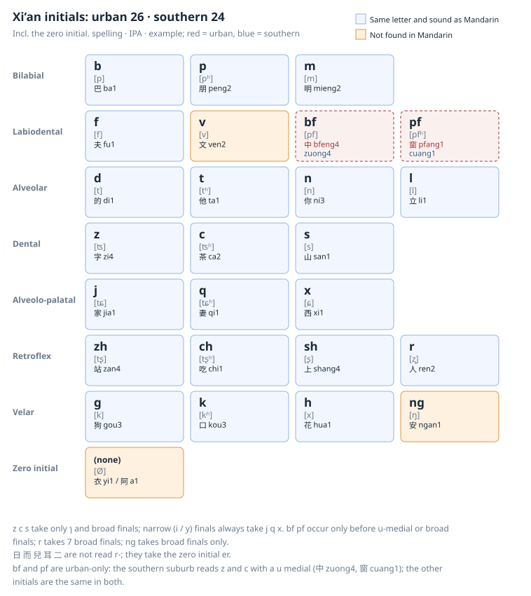
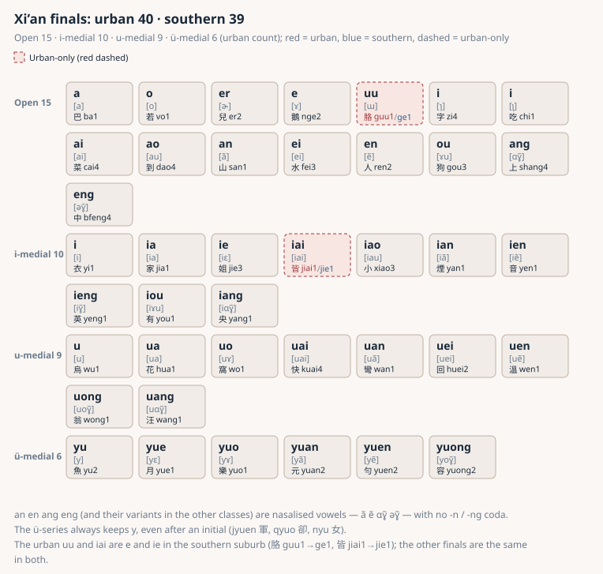
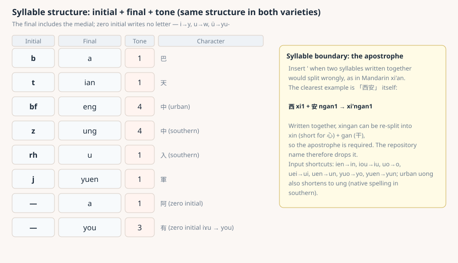
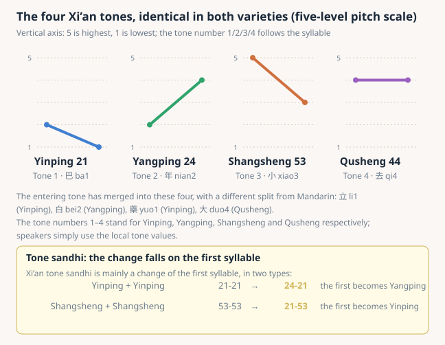
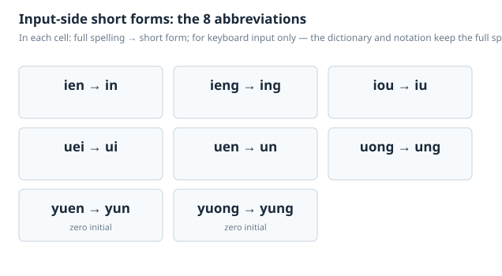

[简体中文](README.md) ｜ [繁體中文](README.zh-Hant.md) ｜ **English** ｜ [日本語](README.ja.md)

> **Android build**: [android-xinganhua](https://github.com/SiqYin/android-xinganhua) — the Xi'an dialect as an install-and-go package for Fcitx5 for Android: install the app and the Rime plugin, and type on your phone with no scheme files to import.

# Xi'an Dialect Input Method · xinganhua-fuvufa

> Type Xi'an dialect in Rime with **Xi'an pinyin** (full spelling + tone digit 1/2/3/4). Two schemas, one per variety: `chengqyu` for the urban accent, `nanjiao` for the southern-suburb accent. The urban readings come from the [osfans/MCPDict Xi'an table](https://github.com/osfans/MCPDict/blob/master/tools/tables/data/%E8%A5%BF%E5%AE%89.tsv) (IPA); the southern ones are folded from the 1,882-character adjudication sheet (2026-11-20) plus the readings shared with the urban variety.





- **Schema code**: `chengqyu` (urban Xi'an) and `nanjiao` (southern-suburb Xi'an); the repository name `xinganhua-fuvufa` is the old spelling of "Xi'an dialect input method" (西 xi1 安 ngan1 话 hua4 ｜ 输 fu1 入 vu1 法 fa1)
- **Character table**: urban 3,648 readings, southern 4,175; urban 3,345 characters, southern 3,931 (incl. 586 found only in the southern data)
- **Phonology**: 24 initials, 38 finals and 4 tones shared (Yinping 21, Yangping 24, Shangsheng 53, Qusheng 44); the urban variety adds `bf`, `pf` (initials) and `uu`, `iai` (finals) — 26 / 40; the southern variety adds `rh` (initial) — 25 / 38
- **Works with**: Rime-family IMEs (Weasel, Squirrel, Trime, fcitx-rime, …)
- **Examples keep the dictionary's traditional glyphs** (鵝, 軍, 豬, 來, 溫 …), because they have to match the data
- **Four languages**: Simplified Chinese / Traditional Chinese / English / 日本語 — switch with the links above; all four say the same thing, and the Simplified version is authoritative

| Schema | Name | Initials | Finals | Dictionary |
|---|---|---|---|---|
| `chengqyu` | Urban Xi'an | 26 (incl. `bf`, `pf`) | 40 (incl. `uu`, `iai`) | `chengqyu.word.dict.yaml`, 3,648 |
| `nanjiao` | Southern-suburb Xi'an | 25 (incl. `rh`) | 38 | `nanjiao.word.dict.yaml`, 4,175 |

---

## Contents

1. [What this scheme is](#s1)
2. [Initials](#s2)
3. [Finals](#s3)
4. [Tones](#s4)
5. [Orthographic details](#s5)
6. [Differences from Mandarin pinyin](#s6)
7. [Quick start](#s7)
8. [Allowed abbreviations](#s8)
9. [Dictionary and character table](#s9)
10. [Files and installation](#s10)
11. [Verifying and rebuilding](#s11)
12. [Open questions](#s12)
13. [Data and credits](#s13)
14. [License](#s14)

---

<a id="s1"></a>

## 1. What this scheme is

A pinyin input scheme for the Xi'an dialect (Guanzhong group, Shaanxi). The spelling system is simply **Xi'an pinyin**, with no separate name: a syllable is written as initial + final + tone digit, e.g. `ba1` 巴, `bfeng4` 中, `jyuen1` 軍.



The urban table (3,648 readings) was transliterated from MCPDict's IPA by script; the southern table (4,350) was folded from the southern adjudication sheet plus the shared readings. After transliteration the 392 urban and 389 southern syllables are each **pairwise distinct (zero homograph conflicts)** — in other words the romanisation is reversible: a spelling maps back to exactly one IPA string.

---

<a id="s2"></a>

## 2. Initials

24 initials shared by the two varieties (23 consonants plus the zero initial); the urban variety adds `bf`, `pf`, making 26, and the southern variety adds `rh`, making 25. The hard distributional rules (synchronic only, no historical reconstruction); those mentioning `bf`, `pf` concern the urban variety and those mentioning `rh` the southern variety only:

- `z c s` (ʦ ʦʰ s) take only `ɿ` and broad finals; narrow finals (starting with i or y) always take `j q x` (ʨ ʨʰ ɕ). Mandarin behaves the same way: z c s are never followed by i- or y- finals.
- `bf pf` (pf pfʰ) appear only before u-medial or broad finals: `bfu` 豬, `bfuo` 捉, `bfan` 磚, `pfang` 窗. The southern suburb has no such initials: they are read z and c with a u medial added — `zu` 豬, `zuo` 捉, `zuan` 磚, `cuang` 窗.
- `rh` (z) is southern-only and combines only with u-medial/broad finals (u ua uo uai uei uan uen uong); the urban counterpart is v: `入 vu1→rhu1`, `若 vo1→rhuo1`, `軟 van3→rhuan3`, `潤 ven4→rhuen4`, `戎 veng2→rhuong2`.
- `r` (ʐ) combines with just 7 broad finals: `re` 熱, `rao` 饒, `ren` 人, `rou` 揉, `ran` 然, `rang` 瓤, `reng` 扔; 日 而 兒 耳 二 are not r- but the zero initial `er`.
- `ng` (ŋ) takes broad finals only: `nge` 我, `ngan` 安, `ngen` 恩, `ngang` 昂, `ngai` 哀, `ngei` 額, `ngao` 熬, `ngou` 歐.
- `v` contrasts with `f`: `ven` 文 ⟂ `fen` 分, `va` 襪 ⟂ `fa` 法.

---

<a id="s3"></a>

## 3. Finals

38 finals shared by the two varieties (15 open / 8 i-medial / 9 u-medial / 6 ü-medial); the urban variety adds `uu`, `iai`, making 40 (16 / 9 / 9 / 6). Zero-initial spellings are the same in both:

| Class | Zero-initial rule | Examples |
|---|---|---|
| Open | no letter added | `a` 阿 a1, `er` 日 er1, `ai`, `ao`, `an`, `ei`, `en`, `ou`, `ang`, `eng` |
| i-medial | `i` → `y` | `i→yi` 衣, `ia→ya` 丫, `ie→ye` 也, `ian→yan` 煙, `ien→yen` 音, `ieng→yeng` 英, `iou→you` 有, `iang→yang` 央 |
| u-medial | `u` → `w` | `u→wu` 烏, `ua→wa` 挖, `uo→wo` 窩, `uai→wai` 外, `uan→wan` 彎, `uei→wei` 威, `uen→wen` 溫, `uong→wong` 翁, `uang→wang` 汪 |
| ü-medial | write `yu-` as is | `yu` 魚, `yue` 月, `yuo` 樂, `yuan` 冤, `yuen` 勻, `yuong` 容 |

The ü-series always keeps `y`, even after an initial: `jyu` 居, `qyuo` 卻, `xyuen` 熏, `nyu` 女, `lyu` 律.

The urban `uu` (`guu` 胳) is `e` (`ge`) in the southern suburb, and `iai` (`jiai` 皆) is `ie` (`jie`).

---

<a id="s4"></a>

## 4. Tones



The tone digit follows the syllable with no space. The entering tone has merged into these four, with a different split from Mandarin: `立 li1` (Yinping; Qusheng in Mandarin), `白 bei2` (Yangping; Yangping), `藥 yuo1` (Yinping; Qusheng), `六 liou1` (Yinping; Qusheng), `十 shi2` (Yangping; Yangping), `大 duo4` (Qusheng; Qusheng).

---

<a id="s5"></a>

## 5. Orthographic details

1. **Apical vowels**: `ɿ` (after z c s) and `ʅ` (after zh ch sh r) are both written `i`; the initial disambiguates them: `zi` 指, `chi` 吃. This matches Mandarin's `zi ci si / zhi chi shi`.
2. **Nasal finals**: `ã ẽ ɑɣ̃ əɣ̃` and their variants in each class are all written with a final `n/ŋ` (`an en ang eng`, `ian ien ieng iang`, `uan uen uong uang`, `yuan yuen yuong`). Note that `uong`/`yuong` stand for `uoɣ̃`/`yoɣ̃`, which is not the same shape as Mandarin `ong/iong`.
3. **Syllable boundaries use an apostrophe**: insert `'` when two syllables written together would be split wrongly — exactly the principle behind Mandarin `xi'an`. The clearest example is 「西安」 itself: `xi1 + ngan1 → xi'ngan1`; written as `xingan` it can be re-split into `xin` (short for 心) + `gan` (干). That is why the repository name drops the apostrophe.
4. **External notation always carries the tone**, and dictionary rows use the toned full spelling; short spellings and toneless forms exist only on the input side (see §8).

---

<a id="s6"></a>

## 6. Differences from Mandarin pinyin

For anyone who already types Mandarin pinyin: the letter system is largely the same, and the differences concentrate in a few initials, a few final spellings, and the pitch values.

**① Identical (type it as is)**

The initials `b p m f d t n l g k h z c s zh ch sh r j q x` stand for the same sounds as in Mandarin (including the aspirated/unaspirated pairs); the finals `a i u e er ai ei ao ou ia ie iao ian iang ua uo uai uan uang` are spelled the same. Examples: `巴 ba1`, `天 tian1`, `小 xiao3`, `到 dao4`, `走 zou3`, `家 jia1`, `花 hua1`, `快 kuai4`, `光 guang1`, `窩 wo1`, `烏 wu1`, `衣 yi1`, `兒 er2`. The y/w rules for zero-initial syllables are exactly Mandarin's.

**② Same letters, different sound**

Every final ending in `-n / -ng` is a **nasalised vowel** in Xi'an, not a nasal coda as in Mandarin: `an = ã`, `en = ẽ`, `ang = ɑɣ̃`, `eng = əɣ̃`. So `山 san1`, `人 ren2`, `上 shang4`, `中 bfeng4` are spelled like Mandarin but pronounced differently.

**③ Spelled differently (relearn these)**

| Mandarin | Xi'an pinyin (same in both) | Example | Note |
|---|---|---|---|
| in | ien | 心 xien1 | Full spelling is not shortened; `in` works as an input abbreviation |
| ing | ieng | 明 mieng2 | same |
| iu | iou | 牛 niou2 | same |
| ui | uei | 回 huei2 | works as an input abbreviation |
| un | uen | 溫 wen1 | zero initial keeps the Mandarin shape wen |
| ong | uong | 東 duong1 | zero initial wong 翁 |
| iong | yuong | 容 yuong2 | ü-medial keeps y |
| ü / üe / üan / ün | yu / yue / yuan / yuen | 魚 yu2, 月 yue1, 元 yuan2, 軍 jyuen1 | always with y, even after an initial |

**④ Extras in the urban variety (absent from the southern suburb)**

- Initials: `bf pf` (豬 bfu1, 窗 pfang1). bf and pf are z and c in the south: 豬 zu1, 窗 cuang1; the south has `rh` instead, absent in the urban variety (see §2).
- Finals: `uu` (胳 guu1), `iai` (皆 jiai1). uu and iai are e and ie in the south: 胳 ge1, 皆 jie1.

**⑤ Characters whose initial does not match (memorise examples, not rules)**

| Mandarin | Urban | Southern | Character |
|---|---|---|---|
| shuǐ | fei3 | suei3 | 水 |
| shū | fu1 | su1 | 書 |
| shuō | she1 | she1 | 說 |
| shān / shì | san1 / si4 | san1 / si4 | 山 / 是 |
| zhū / chū | bfu1 / pfu1 | zu1 / cu1 | 豬 / 出 |
| zhōng / chūn | bfeng4 / pfen1 | zuong4 / cuen1 | 中 / 春 |
| wén | ven2 | ven2 | 文 |
| é / ān | nge2 / ngan1 | nge2 / ngan1 | 鵝 / 安 |
| rì | er1 | er1 | 日 |
| rù | vu1 | rhu1 | 入 |

**⑥ Same digit position, completely different pitch**: Mandarin ā á ǎ à map to 1 2 3 4 here, but the Xi'an values are 21 / 24 / 53 / 44 (see the tone figure). Speakers simply use their local pitch; no conversion is needed.

---

<a id="s7"></a>

## 7. Quick start

| Char. | Mandarin | Xi'an code | | Char. | Mandarin | Xi'an code |
|---|---|---|---|---|---|---|
| 我 | wǒ | `nge3` | | 魚 | yú | `yu2` |
| 你 | nǐ | `ni3` | | 軍 | jūn | `jyuen1` |
| 他 | tā | `ta1` | | 東 | dōng | `duong1` |
| 人 | rén | `ren2` | | 心 | xīn | `xien1` |
| 山 | shān | `san1` | | 明 | míng | `mieng2` |
| 水 | shuǐ | `fei3` | | 有 | yǒu | `you3` |
| 中 | zhōng | `bfeng4` | | 不 | bù | `bu1` |
| 天 | tiān | `tian1` | | 是 | shì | `si4` |
| 家 | jiā | `jia1` | | 立 | lì | `li1` |
| 日 | rì | `er1` | | 大 | dà | `da4` |

- The table shows urban codes; `水 fei3` is `suei3` in the south and `中 bfeng4` is `zuong4`, all other characters are identical.
- The tone digit is optional: `ba` offers all four tones, while `ba1` gives only Yinping.
- Common abbreviations: `in / ing / iu / ui / un / ung / yun / yung` stand for `ien / ieng / iou / uei / uen / uong / yuen / yuong` (zero-initial `you` 有, `wen` 溫 and `wei` 威 are not shortened).
- Reverse lookup: `q` + Mandarin pinyin, or `x` + strokes; the candidate comment shows the Xi'an readings (urban and southern).

---

<a id="s8"></a>

## 8. Allowed abbreviations

### 8.1 Final abbreviations (input side only; dictionary and notation keep the full spelling)

| Full | Short | Condition | Examples |
|---|---|---|---|
| `ien` | `in` | only after an initial | `jien` 今 → jin, `xien` 新 → xin |
| `ieng` | `ing` | only after an initial | `mieng` 明 → ming, `xieng` 行 → xing |
| `iou` | `iu` | only after an initial | `jiou` 究 → jiu, `niou` 牛 → niu |
| `uei` | `ui` | only after an initial | `huei` 回 → hui, `duei` 對 → dui |
| `uen` | `un` | only after an initial | `suen` 孫 → sun, `duen` 墩 → dun |
| `uong` | `ung` | only after an initial | `duong` 冬 → dung, `huong` 烘 → hung |
| `yuen` | `yun` | also with the zero initial | `yuen` 勻 → yun, `jyuen` 軍 → jyun |
| `yuong` | `yung` | also with the zero initial |

 `yuong` 容 → yung, `qyuong` 瓊 → qyung |

**Not allowed** (collisions, or codes outside the scheme):

| Wanted | Result | Why not |
|---|---|---|
| `you` 有 → `yu` | ✗ | identical to `魚 yu` |
| `wen` 溫 → `wn` / `wun` | ✗ | no such syllable division in the scheme |
| `yen` 音, `yeng` 英 → `in`, `ing` | ✗ | the zero initial is not shortened; `in` can only point to `ien` |
| `wong` 翁 → `ung` | ✗ | as above; `wong` keeps its full spelling |
| `yue`, `yuo`, `yuan`, `yu` | no short form | none defined in this table |
| Initial-letter-only typing | not yet | too many single-character homophones; will wait for a fuller dictionary and `abbrev` |

The conditions are expressed with initial anchors in `speller/algebra` of `chengqyu.schema.yaml`; do not take the shortcut of a bare rule: `derive/uen/un/` would also bite zero-initial full spellings such as `yuong` and `yuen`, producing wrong codes. `nanjiao.schema.yaml` uses the same rules minus the `bf`/`pf` anchors and with an `rh` anchor added.

### 8.2 Tones are not typed

**No digits in the input code.** `alphabet` holds the 26 letters only, and `speller/algebra` uses `xform/\d//` to strip the tone digit from every dictionary reading. The tone survives only in the comment (the reading shown beside a candidate) and in the dictionary itself; it never takes part in typing.

The reason is simple: in Rime the keys `1`–`9` select candidates, so a tone digit used as an input code would collide with them. Homophones all come up together (`ba` yields ba1/ba2/ba3/ba4) and are ordered by frequency and context.

### 8.3 Ambiguity check for abbreviations

Running all algebra rules over the 392 urban and 389 southern syllables yields 56 and 62 abbreviated codes (toneless forms) respectively, with **0 cross-syllable ambiguities** and 0 cases where an abbreviated code coincides with another syllable's full spelling. Abbreviations only add typing tolerance; they never make one code produce two unrelated sets of characters.

---

<a id="s9"></a>

## 9. Dictionary and character table

| Item | Urban | Southern |
|---|---|---|
| Readings (one per line) | 3,648 | 4,350 |
| Distinct characters | 3,345 | 4,065 (incl. 720 added characters) |
| Polyphonic characters | 275 | 256 |
| Readings per tone 1/2/3/4 | 1,148 / 826 / 639 / 1,035 | 1,356 / 995 / 788 / 1,205 (plus 6 neutral) |

- Each dictionary line is strictly `character<TAB>single syllable`; the code column never contains a space, so Rime does not read it as a multi-syllable phrase.
- Variant readings carried over from the source table deserve attention when proofreading: `勻 yen2 / yuen2`, `你 ni1 / ni3`, `不 bu1 / bu2`, `來 lai1 / lai2`, `大 da4 / duo4`, `行 hang2 / hang4 / xieng2`.
- Syllables with no character (the source table only gives `□`, not included in the dictionary): `zou2` "~幹: capable", `tai3` "打~: a wood-chopping game", `sao2` "to hit with a whip tip".
- The source uses traditional characters, so Simplified output relies on OpenCC.

---

<a id="s10"></a>

## 10. Files and installation

```
chengqyu.schema.yaml           urban schema: alphabet, abbreviation algebra, Q/X reverse lookup
chengqyu.dict.yaml             urban main dictionary, imports chengqyu.word
chengqyu.word.dict.yaml        urban readings, 3,648 (generated; do not edit by hand)
nanjiao.schema.yaml            southern-suburb schema (25 initials incl. rh, 38 finals)
nanjiao.dict.yaml              southern main dictionary, imports nanjiao.word
nanjiao.word.dict.yaml         southern readings, 4,350 (generated; do not edit by hand)
figures/onsets.hans.svg        initials figure (also .hant / .en / .ja)
figures/rhymes.hans.svg        finals figure (likewise)
figures/tones.hans.svg         tones figure (likewise)
figures/syllable.hans.svg      syllable-structure figure (likewise)
figures/abbrev.hans.svg        abbreviated-spellings figure (likewise)
tools/ipa2pinyin.mjs           IPA → urban pinyin transliterator
tools/make_nanjiao_dict.py     southern table → nanjiao.word.dict.yaml
tools/make-figures.mjs         generates the five figures in all four languages
tools/chengqyu.ipa對照.tsv    urban per-sound table: IPA / tone name / pinyin / initial / final / characters
tools/chengqyu.詳注.tsv       urban per-character notes, including the source table's {} glosses
```

(The two table files keep their traditional-character filenames, matching the files actually in the repository.)

1. Copy these files into your Rime user directory
   - Windows (Weasel): `%APPDATA%\Rime`
   - macOS (Squirrel): `~/Library/Rime`
   - Linux: `~/.config/ibus/rime` or `~/.local/share/fcitx5/rime`

   ```
   chengqyu.schema.yaml
   chengqyu.dict.yaml
   chengqyu.word.dict.yaml
   nanjiao.schema.yaml
   nanjiao.dict.yaml
   nanjiao.word.dict.yaml
   ```

2. Enable the schema in `default.custom.yaml`:

   ```yaml
   patch:
     schema_list:
       - schema: chengqyu
       - schema: nanjiao
       # append any other schemas below as usual
   ```

3. Redeploy (Weasel: right-click the tray icon → "Redeploy").

---

<a id="s11"></a>

## 11. Verifying and rebuilding

All transliteration rules live in three mapping tables at the top of `tools/ipa2pinyin.mjs` (`MR` initials, `FR` finals, `ZR` zero initial). After editing, run this in the repository root:

```sh
node tools/ipa2pinyin.mjs /path/to/西安.tsv
```

The dictionary and both cross-reference tables are regenerated together, and the script reports unmapped syllables, homograph conflicts, toneless/toned syllable counts, and the number of readings and polyphonic characters. After editing the southern table, run `python tools/make_nanjiao_dict.py` to rebuild `nanjiao.word.dict.yaml`. Regenerate the figures with `node tools/make-figures.mjs`, which writes all 16 files under `figures/` (four figures × hans / hant / en / ja) in one go. The abbreviated codes derived by algebra can also be checked with a small simulator that runs the schema rules line by line (used during development, not shipped; it can be added back if needed).

---

<a id="s12"></a>

## 12. Open questions and next steps

1. **Keep `y` in the ü-medial?** Currently `jyu/qyuo/xyuen/nyu/lyu`; compatibility rules for the Mandarin style `ju/qu/xu/nü/lü` are already sketched in the schema comments.
2. **Zero-initial `yen/yeng`**: a mechanical `i→y` result. The Mandarin style `yin/ying` would collide with the abbreviations `in/ing`, so it was not adopted.
3. **Phrase dictionary**: fold by "one reading per character within a word" in bulk and hand-trim polyphonic entries; only after that does sentence-level typing make sense.
4. **Character frequency weights**: currently borrowed from Mandarin via `use_preset_vocabulary` — a stopgap.
5. **Grammar model**: no `.gram` yet, `contextual_suggestions` is off.
6. `reverse_lookup_translator` is the old style in recent librime; kept in line with wugniu_suwu for now, to be replaced if deployment complains.

---

<a id="s13"></a>

## 13. Data and credits

- [osfans/MCPDict](https://github.com/osfans/MCPDict) (`tools/tables/data/西安.tsv`) — urban reading data, IPA
- the southern-suburb adjudication sheet (1,882 characters, fixed 2026-11-20) — source of the southern readings, merged with the shared readings into `nanjiao.word.dict.yaml`
- [wugniu_suwu](https://github.com/SiqYin/wugniu_suwu) (雪萤) — schema architecture, dictionary layout, reverse-lookup style
- [bepemefeve_flypy](https://github.com/SiqYin/bepemefeve_flypy) (雪萤) — layout and figure conventions this README follows

**Verified**: all 3,648 urban readings match the source table character by character and the 392 syllables are pairwise distinct; the southern table has 4,350 readings and 389 syllables with the same property; 0 cross-syllable ambiguities among abbreviated codes.

---

<a id="s14"></a>

## 14. License

The schema configuration (`chengqyu.schema.yaml`, `nanjiao.schema.yaml`), the four-language figures under `figures/`, and this document may be used, modified and redistributed freely. The urban reading data comes from MCPDict's Xi'an table; see that project for its terms.

---

## Note

The Simplified Chinese version is the source; the Traditional version is converted from it with OpenCC, and the English and Japanese versions are translations. All four are meant to be identical; if they diverge, the Simplified version wins. This document was written and translated with AI assistance.
