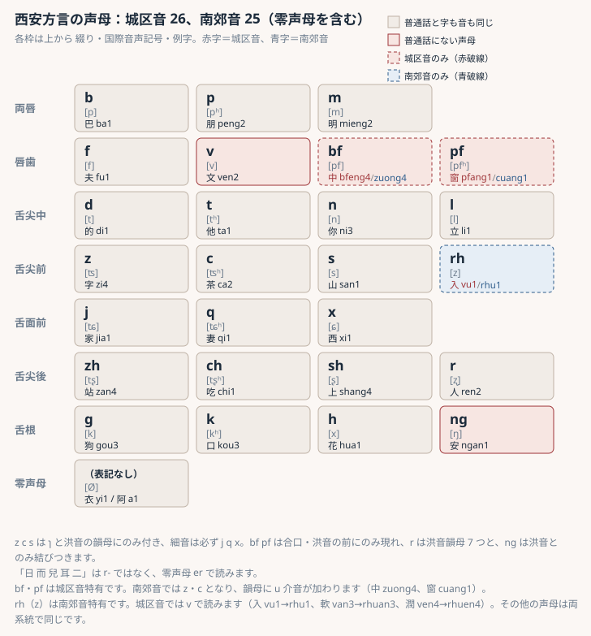
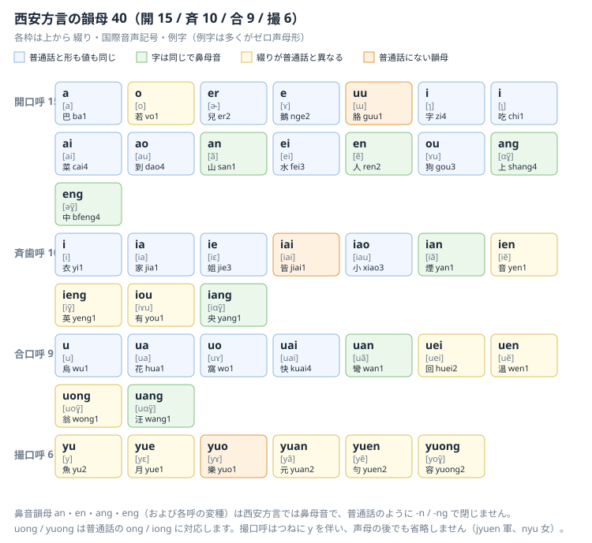
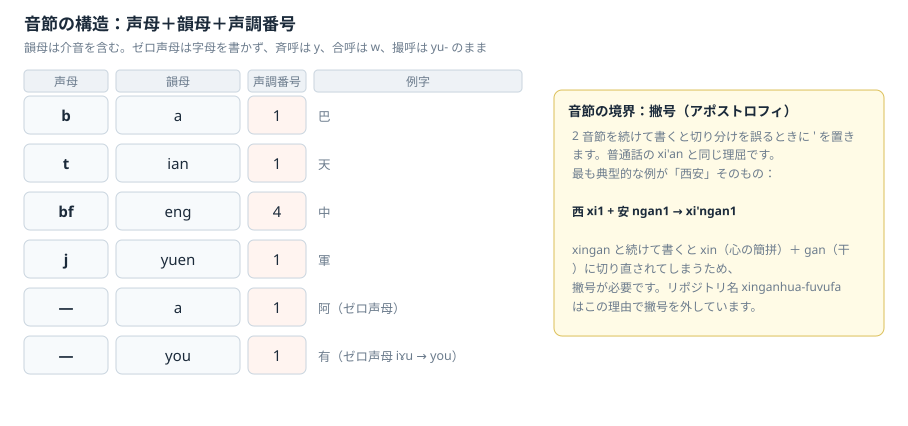
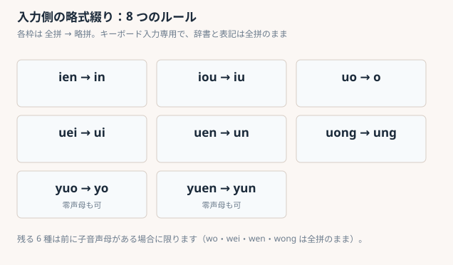
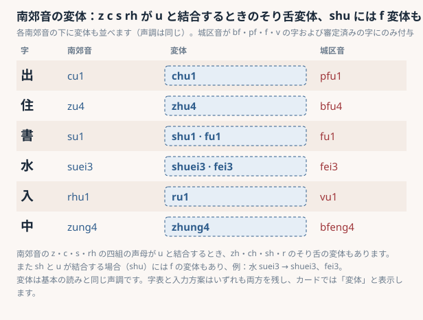

[简体中文](README.md) ｜ [繁體中文](README.zh-Hant.md) ｜ [English](README.en.md) ｜ **日本語**

> **Android 直装版**：[android-xinganhua](https://github.com/SiqYin/android-xinganhua) —— Fcitx5 for Android（小企鹅输入法）に西安方言の 2 方案を組み込んだパッケージです。本体と Rime プラグインを入れれば、設定ファイルを手動で読み込まずにそのまま利用できます。

# 西安方言入力方案 · xinganhua-fuvufa

Rime 向けの西安方言（中原官話・関中片）ピンイン入力方案です。**城区音**（`chengqyu`）と**南郊音**（`nanjiao`）の二系統を並行して保守しています。城区音は MCPDict の「西安」データ表に基づき、南郊音は西安話・渭南話・華県話・臨潼話などの音声資料をもとに一字ずつ校定しました。





- **方案 ID**：`chengqyu`（城区音）・`nanjiao`（南郊音）。リポジトリ名 `xinganhua-fuvufa` は初期綴りによる「西安話入力法」（西 `xi1` 安 `ngan1` 話 `hua4` ｜ 輸 `fu1` 入 `vu1` 法 `fa1`）に由来します。
- **字表規模**：城区音 3,649 件（3,346 字）、南郊音 4,594 件（4,065 字、渭南独自字など 720 字を増補）。
- **音韻体系**：共通 24 声母・四声（陰平 31・陽平 24・上声 53・去声 55）。城区音は 26 声母・39 韻母（`bf`・`pf`・`uu`・`iae`・`uong`）、南郊音は 25 声母・37 韻母（`rh` を加え、`uu`・`iae` を欠き、合口鼻尾韻を本来通り `ung` と表記）。
- **対応環境**：Weasel・Squirrel・Trime・fcitx-rime など Rime 系 IME 各環境。
- **表記方針**：例字は辞書データに合わせ繁体字形（`鵝`・`軍`・`豬`・`來`・`溫` など）を保ちます。上部のリンクから簡体・繁体・英語・日本語を切り替えられます。

| 方案 | 名称 | 声母 | 韻母 | 辞書ファイル |
|---|---|---|---|---|
| `chengqyu` | 西安話城区音 | 26（`bf`・`pf` を含む） | 39（`uu`・`iae`・`uong`） | `chengqyu.word.dict.yaml`（3,649 件） |
| `nanjiao` | 西安話南郊音 | 25（`rh` を含む） | 37（`ung` 表記） | `nanjiao.word.dict.yaml`（4,594 件） |

---

## 目次

1. [方案の概要](#s1)
2. [声母](#s2)
3. [韻母](#s3)
4. [声調](#s4)
5. [正書法の細則](#s5)
6. [普通話ピンインとの対照](#s6)
7. [試用早見表](#s7)
8. [入力側の略式綴り（簡拼）](#s8)
9. [辞書統計](#s9)
10. [ファイル構成と導入](#s10)
11. [検証と再生成](#s11)
12. [今後の課題](#s12)
13. [資料出典と謝辞](#s13)
14. [ライセンス](#s14)

---

<a id="s1"></a>

## 1. 方案の概要

綴り体系はそのまま**西安方言ピンイン**と呼び、城区音と南郊音で共通の記法をとります。1 音節は「声母＋韻母＋声調番号」で書き、`ba1`（巴）・`jyuen1`（軍）のように表します（「中」は城区音 `bfeng4`、南郊音 `zung4`）。



城区音 392 音節・南郊音 420 音節（いずれも声調別を省いた数）は互いに綴りが重複せず、つねに一意な音声記号へ復元できます。

---

<a id="s2"></a>

## 2. 声母

共通 24 声母（子音 23＋零声母）に、城区音は `bf`・`pf` を加えて 26 声母、南郊音は `rh` を加えて 25 声母となります。調音位置順に 6 行＋零声母で配列します：

- **唇音**：`b [p]`・`p [pʰ]`・`m [m]`・`bf [pf]`（城区）・`pf [pfʰ]`（城区）・`f [f]`・`v [v]`
- **舌尖中音**：`d [t]`・`t [tʰ]`・`n [n]`・`l [l]`
- **舌根音**：`g [k]`・`k [kʰ]`・`h [x]`・`ng [ŋ]`
- **舌面前音**：`j [tɕ]`・`q [tɕʰ]`・`x [ɕ]`
- **舌尖後音**：`zh [ʈʂ]`・`ch [ʈʂʰ]`・`sh [ʂ]`・`r [ɻ]`
- **舌尖前音**：`z [ts]`・`c [tsʰ]`・`s [s]`・`rh [z]`（南郊）

結合規則は次のとおりです：

- **`n` の細音異音**：`i`・`y` で始まる細音韻母の前では `[ȵ]`（`你 ni3`・`女 nyu3`）となり、開口呼・合口呼では `[n]`（`南 nan2`・`挪 nuo2`）を保ちます。
- **平舌音と団音**：`z c s`（`[ts tsʰ s]`）は `[ɿ]` と洪音のみに付き、細音の前では必ず `j q x`（`[tɕ tɕʰ ɕ]`）になります。
- **唇歯破擦音 `bf`・`pf`**：城区音のみ合口・洪音に現れます（`bfu` 豬・`bfuo` 捉・`bfan` 磚・`pfang` 窗）。南郊音では `u` 介音を伴う `z`・`c` に合流します（`zu` 豬・`zuo` 捉・`zuan` 磚・`cuang` 窗）。
- **南郊音の `rh`**：`[z]` にあたり、合口韻母（`u ua uo uae uei uan uen ung`）にのみ付いて城区音の `v` に対応します（`入 vu1→rhu1`・`若 vuo1→rhuo1`・`軟 van3→rhuan3`・`潤 ven4→rhuen4`）。
- **そり舌 `r`**：7 種の洪音韻母（`re` 熱・`rao` 饒・`ren` 人・`rou` 揉・`ran` 然・`rang` 瓤・`reng` 扔）にのみ付きます。日・而・兒・耳・二は零声母 `er` です。
- **軟口蓋鼻音 `ng`**：洪音のみに付きます（`nge` 鵝・`ngan` 安・`ngen` 恩・`ngang` 昂・`ngae` 哀・`ngei` 額・`ngao` 熬・`ngou` 歐）。
- **`v` と `f` の対立**：`ven` 文 ⟂ `fen` 分、`va` 襪 ⟂ `fa` 法。

---

<a id="s3"></a>

## 3. 韻母

城区音は 39 韻母（開 14／斉 10／合 9／撮 6）、南郊音は 37 韻母（開 13／斉 9／合 9／撮 6；`uu [ɯ]`・`iae [iæ]` がなく、合口鼻尾韻をそのまま `ung [uŋ]` と記します）：

- **開口呼（14）**：`a [a]`・`e [ɤ]`・`uu [ɯ]`（城区）・`i [ɿ]`（`zi ci si rhi`）・`i [ʅ]`（`zhi chi shi ri`）・`ae [æ]`・`ei [ei]`・`ao [au]`・`ou [ɤu]`・`an [ã]`・`en [ẽ]`・`ang [aŋ]`・`eng [əŋ]`・`er [ɚ]`
- **斉歯呼（10）**：`i [i]`・`ia [ia]`・`ie [iɛ]`・`iae [iæ]`（城区）・`iao [iau]`・`iou [iɤu]`・`ian [iã]`・`ien [iɛ̃]`・`iang [iaŋ]`・`ing [iŋ]`
- **合口呼（9）**：`u [u]`・`ua [ua]`・`uo [uɤ]`・`uae [uæ]`・`uei [uei]`・`uan [uã]`・`uen [uẽ]`・`uang [uaŋ]`・`uong [uɤŋ]`（城区）／ `ung [uŋ]`（南郊）
- **撮口呼（6）**：`yu [y]`・`yuo [yɤ]`・`yue [yɛ]`・`yuan [yã]`・`yuen [yɛ̃]`・`yung [yŋ]`

零声母の綴りは両系統共通です：

| 呼 | 零声母の規則 | 例 |
|---|---|---|
| 開口呼 | 補助文字なし | `a` 阿・`er` 日・`ae`・`ao`・`an`・`ei`・`en`・`ou`・`ang`・`eng` |
| 斉歯呼 | `i` → `y` | `yi` 衣・`ya` 丫・`ye` 也・`yae` 涯・`yao` 耀・`you` 有・`yan` 煙・`yen` 音・`yang` 央・`ying` 英 |
| 合口呼 | `u` → `w` | `wu` 烏・`wa` 挖・`wo` 窩・`wae` 外・`wei` 威・`wan` 彎・`wen` 溫・`wang` 汪・`wong` 翁（城区）／`wung` 翁（南郊） |
| 撮口呼 | `yu-` のまま | `yu` 魚・`yuo` 樂・`yue` 月・`yuan` 冤・`yuen` 勻・`yung` 容 |

撮口呼は子音声母の後でも `y` を省きません（`jyu` 居・`qyuo` 卻・`xyuen` 熏・`nyu` 女・`lyu` 律）。城区音の `uu`（`guu` 胳）と `iae`（`jiae` 皆）は南郊音で `e`（`ge`）・`ie`（`jie`）に合流します。

---

<a id="s4"></a>

## 4. 声調


調号は音節末尾に空白なしで記します。旧入声字は四声へ統合されており、たとえば `立 li1`（陰平）・`白 bei2`（陽平）・`藥 yuo1`（陰平）・`六 liou1`（陰平）・`十 shi2`（陽平）・`大 duo4`（去声）と分かれます。

**連続変調**：二音節が続くときは前の字が変化し、陰平＋陰平（`31-31`）では前字が陽平（`24-31`）に、上声＋上声（`53-53`）では前字が陰平（`31-53`）に変わります。

---

<a id="s5"></a>

## 5. 正書法の細則

1. **舌尖母音**：`z c s rh` の後の `[ɿ]` と `zh ch sh r` の後の `[ʅ]` はともに `i` と綴ります（`zi` 指・`chi` 吃）。
2. **鼻母音と軟口蓋鼻音尾**：`-n` で綴る韻母（`an en ian ien uan uen yuan yuen`）は鼻母音 `[ã ẽ iã iɛ̃ uã uẽ yã yɛ̃]` であり、歯茎鼻音尾はありません。`-ng` で綴る韻母（`ang eng iang ing uang`・城区 `uong` / 南郊 `ung`・`yung`）は軟口蓋鼻音 `[-ŋ]` で閉じ、城区音は渡り音を含む `uong [uɤŋ]`、南郊音は `[uŋ]` に合わせて本来通り `ung` と書きます。
3. **音節境界のアポストロフィ**：連接して誤分割される箇所には `'` を挿みます（例：`xi'ngan1` 西安。`xingan` と続けると `xin`＋`gan` に切られます）。
4. **標準表記と簡拼の分離**：辞書・注記には常に声調つきの全拼を用い、簡拼と声調省略はキー入力時のみ働きます（§8）。

---

<a id="s6"></a>

## 6. 普通話ピンインとの対照

**① 綴りと音価が対応する声母・韻母**

`b p m f d t n l g k h z c s zh ch sh r j q x` の無気／有気の対立は普通話と一致します（`n` は細音の前で `[ȵ]`）。韻母 `a i u e er ae ei ao ou ia ie iao ian iang ing ua uo uae uan uang` も概ね共通です（`巴 ba1`・`天 tian1`・`小 xiao3`・`到 dao4`・`走 zou3`・`家 jia1`・`明 ming2`・`花 hua1`・`快 kuae4`・`光 guang1`・`窩 wo1`・`烏 wu1`・`衣 yi1`・`兒 er2`）。

**② 同形ながら音価が異なる点**

`-n` 韻母はすべて鼻母音（`山 san1`・`人 ren2`・`音 yen1`・`溫 wen1`）です。また陰平は低降調 `31`、去声は高平調 `55` となります。

**③ 綴りが異なる韻母**

| 普通話 | 西安方言ピンイン | 例 | 備考 |
|---|---|---|---|
| in | `ien` | 心 `xien1` | 全拼は省かず、入力時のみ `in` 可 |
| iu | `iou` | 牛 `niou2` | 全拼は `o` を残し、入力時のみ `iu` 可 |
| ui | `uei` | 回 `huei2` | 全拼は `e` を残し、入力時のみ `ui` 可 |
| un | `uen` | 溫 `wen1` | 零声母では普通話と同じ `wen` |
| ong | 城区 `uong`／南郊 `ung` | 東 `duong1`／`dung1` | 城区 `[uɤŋ]`（零声母 `wong`）・南郊 `[uŋ]`（零声母 `wung`） |
| iong | `yung` | 容 `yung2` | `y` を保つ |
| ü / üe / üan / ün | `yu / yue / yuan / yuen` | 魚 `yu2`・月 `yue1`・元 `yuan2`・軍 `jyuen1` | 子音の後でも `y` を省略しない |

**④ 城区音・南郊音それぞれの特徴**

- 城区音には `bf`・`pf`（`豬 bfu1`・`窗 pfang1`）と `uu`・`iae`（`胳 guu1`・`皆 jiae1`）があり、南郊音では `z/c`＋`u` 介音（`zu1`・`cuang1`）および `e/ie`（`ge1`・`jie1`）になります。
- 南郊音には `rh`（`入 rhu1`・`若 rhuo1`）があり、城区音の `v`（`vu1`・`vuo1`）に対応します。

**⑤ 声母の対応が異なる主な字**

| 普通話 | 城区音 | 南郊音 | 字 |
|---|---|---|---|
| shuǐ | `fei3` | `suei3` | 水 |
| shū | `fu1` | `su1` | 書 |
| shuō | `she1` | `she1` | 說 |
| shān / shì | `san1 / si4` | `san1 / si4` | 山 / 是 |
| zhū / chū | `bfu1 / pfu1` | `zu1 / cu1` | 豬 / 出 |
| zhōng / chūn | `bfeng4 / pfen1` | `zung4 / cuen1` | 中 / 春 |
| wén | `ven2` | `ven2` | 文 |
| é / ān | `nge2 / ngan1` | `nge2 / ngan1` | 鵝 / 安 |
| rì | `er1` | `er1` | 日 |
| rù | `vu1` | `rhu1` | 入 |

---

<a id="s7"></a>

## 7. 試用早見表

| 字 | 普通話 | 西安方言 | | 字 | 普通話 | 西安方言 |
|---|---|---|---|---|---|---|
| 我 | wǒ | `nge3` | | 魚 | yú | `yu2` |
| 你 | nǐ | `ni3` | | 軍 | jūn | `jyuen1` |
| 他 | tā | `ta1` | | 東 | dōng | `duong1` |
| 人 | rén | `ren2` | | 心 | xīn | `xien1` |
| 山 | shān | `san1` | | 明 | míng | `ming2` |
| 水 | shuǐ | `fei3` | | 有 | yǒu | `you3` |
| 中 | zhōng | `bfeng4` | | 不 | bù | `bu1` |
| 天 | tiān | `tian1` | | 是 | shì | `si4` |
| 家 | jiā | `jia1` | | 立 | lì | `li1` |
| 日 | rì | `er1` | | 大 | dà | `da4` |

上表は城区音です（南郊音は「水」`suei3`、「中」`zung4`、「東」`dung1`、他は同形）。実際の入力では調号を省けます（`ba` で四声すべて提示）。普通話からの逆引きは `` ` `` に続けて打ちます（例 `` `zhong ``、末尾 `;` 省略可）。`q`・`x` を正規の声母として使うため、画数逆引きは廃止しています。

---

<a id="s8"></a>

## 8. 入力側の略式綴り（簡拼）

### 8.1 簡拼ルール（城区音 9 種・南郊音 8 種）

`o` 韻母が `uo` へ統合されたことで、子音声母の後に限り `uo→o`、さらに撮口の `yuo` は `j q x` の後でも `o` に略せます（`j q x` は `uo` と結合しないため対立しません）。零声母と `n` の後では `yo` と書きます。一方 `ing`・`yung` は全拼そのものとなったため簡拼規則から外しています。`uong → ung` については、**城区音のピンインはこのように簡略化できますが、南郊音は本来の綴りそのものが後者（`ung`）です**：

| 全拼 | 簡拼 | 条件 | 例 |
|---|---|---|---|
| `ien` | `in` | 前に子音声母あり | `jien` 今 → `jin`・`xien` 新 → `xin` |
| `iou` | `iu` | 前に子音声母あり | `jiou` 究 → `jiu`・`niou` 牛 → `niu` |
| `uo` | `o` | 前に子音声母あり | `duo` 多 → `do`・`vuo` 勿 → `vo` |
| `uei` | `ui` | 前に子音声母あり | `huei` 回 → `hui`・`duei` 對 → `dui` |
| `uen` | `un` | 前に子音声母あり | `suen` 孫 → `sun`・`duen` 墩 → `dun` |
| `uong` | `ung` | **城区音のみ**（前に子音声母あり） | 城区 `duong` 冬 → `dung`（南郊は元々 `dung`） |
| `yuo` | `o` | `j q x` の後に限る | `jyuo` 覺 → `jo`・`qyuo` 卻 → `qo`・`xyuo` 學 → `xo` |
| `yuo` | `yo` | 零声母、および `n` の後（`nuo` と `nyuo` が対立するため `no` とはしない） | `yuo` 藥 → `yo`・`nyuo` 握 → `nyo` |
| `yuen` | `yun` | 零声母も許容 | `yuen` 勻 → `yun`・`jyuen` 軍 → `jyun` |





**南郊音の変体**：南郊音で `z`・`c`・`s`・`rh` が `u` と結合する際、そり舌の `zh`・`ch`・`sh`・`r` 変体があり、`sh+u` にはさらに `f` 変体も置かれます。城区音が `bf`・`pf`・`f`・`v` の字および審定済み渭南独自字に付与されます（例：水 `suei3` → `shuei3`・`fei3`）。

**廃止した旧略式**：`qyo`・`jyo`・`xyo` は `qo`・`jo`・`xo` に置き換えました（`nyo` は存続）。

**許可しない省略**：`you` → `yu`（`魚 yu` と衝突）、零声母の `yen`・`wo`・`wei`・`wen`・城区 `wong` / 南郊 `wung`、および `yue`・`yuan`・`yu`・`yung`。

### 8.2 声調番号を入力しない理由

`1`〜`9` は候補選択キーに充てられるため、`speller/algebra` の `xform/\d//` により入力キーから調号を除き、候補注記にのみ残しています。

### 8.3 曖昧性チェック

`librime` にて城区 392 音節・南郊 420 音節を全数検査した結果、それぞれの簡拼規則による**音節間の衝突は 0 件**、全拼との同形衝突も 0 件です。

---

<a id="s9"></a>

## 9. 辞書統計

| 項目 | 城区音（`chengqyu`） | 南郊音（`nanjiao`） |
|---|---|---|
| 収録件数（1 行 1 読み） | 3,649 | 4,594 |
| 見出し字数 | 3,346 | 4,065（追加 720 字を含む） |
| 多音字 | 275 | 428（変体除き 256） |
| 声調別件数 1/2/3/4 | 1,149 / 826 / 639 / 1,035 | 1,431 / 1,044 / 842 / 1,271（軽声 6） |

辞書はすべて `字<TAB>全拼+調号` 形式です。`勻 yen2 / yuen2`・`你 ni1 / ni3`・`不 bu1 / bu2`・`來 lae1 / lae2`・`大 da4 / duo4`・`行 hang2 / hang4 / xing2` などの多音字を収録する一方、原表で字形欠如（`□`）の 3 音節（`zou2`・`tae3`・`sao2`）は辞書に含めていません。

---

<a id="s10"></a>

## 10. ファイル構成と導入

```
chengqyu.schema.yaml           城区音スキーマ
chengqyu.dict.yaml             城区音メイン辞書
chengqyu.word.dict.yaml        城区音単字表（自動生成）
nanjiao.schema.yaml            南郊音スキーマ
nanjiao.dict.yaml              南郊音メイン辞書
nanjiao.word.dict.yaml         南郊音単字表（自動生成）
figures/*.svg                  6 種 × 4 言語の図版（計 24 枚）
tools/ipa2pinyin.mjs           IPA → 城区音ピンイン変換スクリプト
tools/make_nanjiao_dict.py     南郊音単字表生成スクリプト
tools/make-figures.mjs         図版生成スクリプト
tools/chengqyu.ipa對照.tsv    城区音 IPA 対照表
tools/chengqyu.詳注.tsv       城区音詳注表
```

導入時は 6 つの `.yaml` ファイルを Rime のユーザーフォルダへ配置し、`default.custom.yaml` の `schema_list` に `chengqyu` と `nanjiao` を追記して再デプロイしてください。

---

<a id="s11"></a>

## 11. 検証と再生成

城区音はリポジトリ直下で `node tools/ipa2pinyin.mjs /path/to/西安.tsv`、南郊音は `python tools/make_nanjiao_dict.py`、図版は `node tools/make-figures.mjs` で一括再生成できます。

---

<a id="s12"></a>

## 12. 今後の課題

1. **撮口呼の `y` 表記**：現行の `jyu/qyuo/xyuen/nyu/lyu` に加え、普通話式 `ju/qu/xu/nü/lü` の互換規則をスキーマ内コメントに用意しています。
2. **零声母 `yen`**：規則どおり `i→y` を適用しています（`yin` は `ien` の簡拼 `in` と競合するため不採用）。
3. **熟語辞書と頻度データ**：現在は `use_preset_vocabulary` を借用しています。単字表の安定後に熟語辞書と `.gram` モデルを整備する予定です。
4. `reverse_lookup_translator` は `wugniu_suwu` と揃えて維持しています。

---

<a id="s13"></a>

## 13. 資料出典と謝辞

- [西安話資料](https://github.com/osfans/MCPDict/blob/master/tools/tables/data/%E8%A5%BF%E5%AE%89.tsv)・[渭南話資料](https://github.com/osfans/MCPDict/blob/master/tools/tables/data/%E6%B8%AD%E5%8D%97.tsv)・[華県話資料](https://github.com/osfans/MCPDict/blob/master/tools%2Ftables%2Fdata%2F%E5%8D%8E%E5%8E%BF.tsv)・[臨潼話資料](https://github.com/osfans/MCPDict/blob/master/tools%2Ftables%2Fdata%2F%E4%B8%B4%E6%BD%BC%E6%96%B9%E8%A8%80%E8%AF%AD%E9%9F%B3%E7%A0%94%E7%A9%B6.tsv)（[osfans/MCPDict](https://github.com/osfans/MCPDict)）。西安話資料が城区音の原典で、残る三表は南郊音整理時の参照資料です。
- **南郊話の字音**：既成の字表がないため、上記四資料を下敷きに知乎上の平舌・そり舌合流に関する議論を参照し、筆者本人および家族の発音と一字ずつ照合してまとめた**参考データ**です。
- [wugniu_suwu](https://github.com/SiqYin/wugniu_suwu)・[bepemefeve_flypy](https://github.com/SiqYin/bepemefeve_flypy) —— スキーマ構成と図版書式の参考元。

---

<a id="s14"></a>

## 14. ライセンス

本リポジトリ内の設定ファイル・図版・解説文書は自由に使用・改変・再配布できます。字音データの利用条件は MCPDict に準じます。
