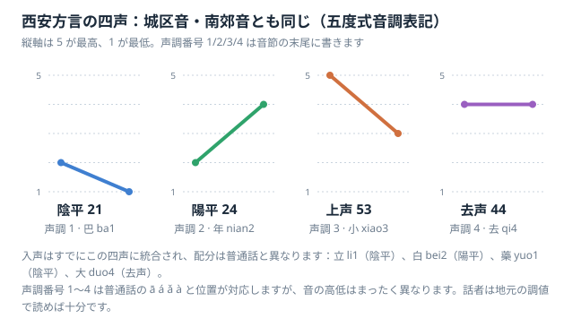

[简体中文](README.md) ｜ [繁體中文](README.zh-Hant.md) ｜ [English](README.en.md) ｜ **日本語**

# 西安方言輸入法 · xinganhua-fuvufa

> **西安方言ピンイン**（全拼＋声調番号 1/2/3/4）で Rime に西安方言を打ち込むための方案です。字音は [osfans/MCPDict「西安」データ表](https://github.com/osfans/MCPDict/blob/master/tools/tables/data/%E8%A5%BF%E5%AE%89.tsv)（国際音声記号）から一字ずつ転写したもので、同形衝突はありません。


- **方案コード**：`xinganhua`（リポジトリ名 `xinganhua-fuvufa` は本方案の綴りで「西安話輸入法」：西 xi1 安 ngan1 话 hua4 ｜ 输 fu1 入 vu1 法 fa1）
- **字表**：字音 3,648 件 / 字頭 3,345 字 / 多音字 275 字。声調なし音節 392、声調つき音節 1,158
- **音韻**：声母 26（零声母を含む）、韻母 40、四声（陰平 21、陽平 24、上声 53、去声 44）
- **対応**：Rime 系入力（Weasel / Squirrel / Trime / fcitx-rime など）
- **例字は字表の繁体字のまま**（鵝、軍、豬、來、溫 …）。データと突き合わせる必要があるためです
- **四言語**：簡体中文 / 繁體中文 / English / 日本語。上のリンクで切り替えられます。内容は四版とも同じで、簡体版を正とします

---

## 目次

1. [この方案は何か](#s1)
2. [声母](#s2)
3. [韻母](#s3)
4. [声調](#s4)
5. [正書法の細則](#s5)
6. [普通話ピンインとの異同](#s6)
7. [はじめかた](#s7)
8. [許される略式綴り](#s8)
9. [辞書と字表](#s9)
10. [ファイルと導入](#s10)
11. [検証と再生成](#s11)
12. [未決と今後](#s12)
13. [データと謝辞](#s13)
14. [ライセンス](#s14)

---

<a id="s1"></a>

## 1. この方案は何か

西安方言（陝西省・関中片）のピンイン入力方案（スキーム）です。綴り体系はそのまま**西安方言ピンイン**で、別の名前は設けていません。1 音節は「声母＋韻母＋声調番号」で書き、たとえば `ba1` 巴、`bfeng4` 中、`jyuen1` 軍。


字音 3,648 件はすべて、MCPDict の国際音声記号からスクリプトで一字ずつ転写したものです。転写後の 392 音節は**綴りが互いに重複しません（同形衝突ゼロ）**。つまりこのローマ字表記は可逆で、綴りから元の音声記号をそのまま復元できます。

---

<a id="s2"></a>

## 2. 声母

声母は 26 個（子音 25 個＋零声母）。冒頭の声母図を参照してください。分布上の規則は次のとおりです（共時的分布のみを述べ、音類の考証はしません）。

- `z c s`（ʦ ʦʰ s）は `ɿ` と洪音の韻母にのみ付き、細音（i・y で始まるもの）には必ず `j q x`（ʨ ʨʰ ɕ）を用います。普通話も同じで、z c s の後に i・y で始まる韻母は来ません。
- `bf pf`（pf pfʰ）は合口・洪音の韻母の前にのみ現れます：`bfu` 豬、`bfuo` 捉、`bfan` 磚、`pfang` 窗。
- `r`（ʐ）は洪音韻母 7 つだけと結びつきます：`re` 熱、`rao` 饒、`ren` 人、`rou` 揉、`ran` 然、`rang` 瓤、`reng` 扔。日 而 兒 耳 二 は r- ではなく、零声母の `er` で読みます。
- `ng`（ŋ）は洪音とのみ結びつきます：`nge` 我、`ngan` 安、`ngen` 恩、`ngang` 昂、`ngai` 哀、`ngei` 額、`ngao` 熬、`ngou` 歐。
- `v` は `f` と対立します：`ven` 文 ⟂ `fen` 分、`va` 襪 ⟂ `fa` 法。

---

<a id="s3"></a>

## 3. 韻母

韻母は 40 個（開 15 / 斉 10 / 合 9 / 撮 6）。冒頭の韻母図を参照してください。零声母の書き方は次のとおりです。

| 呼 | 零声母の規則 | 例 |
|---|---|---|
| 開口呼 | 字母を加えない | `a` 阿 a1、`er` 日 er1、`ai`、`ao`、`an`、`ei`、`en`、`ou`、`ang`、`eng` |
| 斉歯呼 | `i` を `y` に | `i→yi` 衣、`ia→ya` 丫、`ie→ye` 也、`ian→yan` 煙、`ien→yen` 音、`ieng→yeng` 英、`iou→you` 有、`iang→yang` 央 |
| 合口呼 | `u` を `w` に | `u→wu` 烏、`ua→wa` 挖、`uo→wo` 窩、`uai→wai` 外、`uan→wan` 彎、`uei→wei` 威、`uen→wen` 溫、`uong→wong` 翁、`uang→wang` 汪 |
| 撮口呼 | `yu-` のまま | `yu` 魚、`yue` 月、`yuo` 樂、`yuan` 冤、`yuen` 勻、`yuong` 容 |

撮口呼はつねに `y` を伴い、声母の後でも省略しません：`jyu` 居、`qyuo` 卻、`xyuen` 熏、`nyu` 女、`lyu` 律。

---

<a id="s4"></a>

## 4. 声調



声調番号は音節の直後に、空白を入れずに書きます。入声はすでにこの四声に統合されており、その配分は普通話と異なります：`立 li1`（陰平、普通話では去声）、`白 bei2`（陽平、陽平）、`藥 yuo1`（陰平、去声）、`六 liou1`（陰平、去声）、`十 shi2`（陽平、陽平）、`大 duo4`（去声、去声）。

---

<a id="s5"></a>

## 5. 正書法の細則

1. **舌尖母音**：`ɿ`（z c s の後）と `ʅ`（zh ch sh r の後）はどちらも `i` と書きます。声母で限定されるので混じりません：`zi` 指、`chi` 吃。普通話の `zi ci si / zhi chi shi` と同じ書き方です。
2. **鼻音韻母**：`ã ẽ ɑɣ̃ əɣ̃` および各呼の変種は、すべて `n/ŋ` の尾で書きます（`an en ang eng`、`ian ien ieng iang`、`uan uen uong uang`、`yuan yuen yuong`）。`uong`/`yuong` が対応するのは `uoɣ̃`/`yoɣ̃` で、普通話の `ong/iong` とは形が異なります。
3. **音節の境界は撇号（アポストロフィ）**：2 音節を続けて書くと切り分けを誤る場合に `'` を置きます。普通話の `xi'an` と同じ理屈です。最も典型的な例が「西安」そのもの：`xi1 + ngan1 → xi'ngan1`。`xingan` と続けて書くと `xin`（心の簡拼）＋ `gan`（干）に切り直されてしまいます。リポジトリ名が撇号を外しているのはこのためです。
4. **外部向けの表記はつねに声調つき**で、辞書の行も声調つきの全拼です。簡拼と声調省略は入力側にのみ存在します（第 8 節）。

---

<a id="s6"></a>

## 6. 普通話ピンインとの異同

普通話ピンインを打てる人向けの整理です。字母の体系はほぼ同じで、違いは少数の声母、少数の韻母の綴り、そして調値に集中しています。

**① まったく同じ（そのまま打てる）**

声母 `b p m f d t n l g k h z c s zh ch sh r j q x` は字も音も普通話と一致します（無気／有気の関係も同じ）。韻母 `a i u e er ai ei ao ou ia ie iao ian iang ua uo uai uan uang` の綴りも同じです。例：`巴 ba1`、`天 tian1`、`小 xiao3`、`到 dao4`、`走 zou3`、`家 jia1`、`花 hua1`、`快 kuai4`、`光 guang1`、`窩 wo1`、`烏 wu1`、`衣 yi1`、`兒 er2`。零声母の y/w の規則も普通話とまったく同じです。

**② 綴りは同じで音価が異なる**

`-n / -ng` で終わる韻母は、西安方言ではすべて**鼻母音**で、普通話のように鼻音尾で閉じません：`an = ã`、`en = ẽ`、`ang = ɑɣ̃`、`eng = əɣ̃`。したがって `山 san1`、`人 ren2`、`上 shang4`、`中 bfeng4` は綴りが普通話と同じでも、発音は異なります。

**③ 綴りが異なる（覚え直すもの）**

| 普通話 | 西安方言ピンイン | 例 | 説明 |
|---|---|---|---|
| in | ien | 心 xien1 | 全拼は省略しない。入力時は in で簡拼可 |
| ing | ieng | 明 mieng2 | 同上 |
| iu | iou | 牛 niou2 | 同上 |
| ui | uei | 回 huei2 | 省略しない |
| un | uen | 溫 wen1 | 零声母では普通話と同じ wen |
| ong | uong | 東 duong1 | 零声母は wong 翁 |
| iong | yuong | 容 yuong2 | 撮口呼は y を伴う |
| ü / üe / üan / ün | yu / yue / yuan / yuen | 魚 yu2、月 yue1、元 yuan2、軍 jyuen1 | つねに y を伴い、声母の後でも省略しない |

**④ 西安方言にしかないもの**

- 声母：`bf pf`（豬 bfu1、窗 pfang1）、`v`（文 ven2）、`ng`（安 ngan1）
- 韻母：`uu`（胳 guu1）、`o`（`vo` のみ：若 vo1）、`iai`（皆 jiai1）、`yuo`（樂 yuo1）

**⑤ 声母が対応しない字（規則ではなく例で覚える）**

| 普通話 | 西安方言ピンイン | 字 |
|---|---|---|
| shuǐ | fei3 | 水 |
| shū | fu1 | 書 |
| shuō | she1 | 說 |
| shān / shì | san1 / si4 | 山 / 是 |
| zhū / chū | bfu1 / pfu1 | 豬 / 出 |
| zhōng / chūn | bfeng4 / pfen1 | 中 / 春 |
| wén | ven2 | 文 |
| é / ān | nge2 / ngan1 | 鵝 / 安 |
| rì | er1 | 日 |

**⑥ 声調番号の位置は同じで、調値はまったく異なる**：普通話の ā á ǎ à は本方案の 1 2 3 4 に対応しますが、西安方言の調値は 21 / 24 / 53 / 44 です（声調図を参照）。話者は地元の調値でそのまま読めばよく、換算は不要です。

---

<a id="s7"></a>

## 7. はじめかた

| 字 | 普通話 | 西安方言コード | | 字 | 普通話 | 西安方言コード |
|---|---|---|---|---|---|---|
| 我 | wǒ | `nge3` | | 魚 | yú | `yu2` |
| 你 | nǐ | `ni3` | | 軍 | jūn | `jyuen1` |
| 他 | tā | `ta1` | | 東 | dōng | `duong1` |
| 人 | rén | `ren2` | | 心 | xīn | `xien1` |
| 山 | shān | `san1` | | 明 | míng | `mieng2` |
| 水 | shuǐ | `fei3` | | 有 | yǒu | `you3` |
| 中 | zhōng | `bfeng4` | | 不 | bù | `bu1` |
| 天 | tiān | `tian1` | | 是 | shì | `si4` |
| 家 | jiā | `jia1` | | 立 | lì | `li1` |
| 日 | rì | `er1` | | 大 | dà | `da4` |

- 声調番号は省略できます：`ba` で四声すべての候補、`ba1` で陰平のみ。
- よく使う簡拼：`in / ing / iu / un / ung / yun / yung` はそれぞれ `ien / ieng / iou / uen / uong / yuen / yuong` に対応します（零声母の `you` 有、`wen` 溫 は省略しません）。
- 逆引き：`q` ＋普通話ピンイン、`x` ＋画数。候補の注記に西安方言の読みが出ます。

---

<a id="s8"></a>

## 8. 許される略式綴り

### 8.1 韻母の簡拼（入力側のみ。辞書と表記は全拼のまま）

| 全拼 | 簡拼 | 条件 | 例 |
|---|---|---|---|
| `ien` | `in` | 前に声母がある場合のみ | `jien` 今 → jin、`xien` 新 → xin |
| `ieng` | `ing` | 前に声母がある場合のみ | `mieng` 明 → ming、`xieng` 行 → xing |
| `iou` | `iu` | 前に声母がある場合のみ | `jiou` 究 → jiu、`niou` 牛 → niu |
| `uen` | `un` | 前に声母がある場合のみ | `suen` 孫 → sun、`duen` 墩 → dun |
| `uong` | `ung` | 前に声母がある場合のみ | `duong` 冬 → dung、`huong` 烘 → hung |
| `yuen` | `yun` | 零声母も可 | `yuen` 勻 → yun、`jyuen` 軍 → jyun |
| `yuong` | `yung` | 零声母も可 | `yuong` 容 → yung、`qyuong` 瓊 → qyung |

**許されない省略**（衝突するか、方案にないコードになる）：

| 省略したい形 | 結果 | なぜ駄目か |
|---|---|---|
| `you` 有 → `yu` | ✗ | `魚 yu` と同形 |
| `wen` 溫 → `wn` / `wun` | ✗ | 方案にこのような音節分割はない |
| `yen` 音、`yeng` 英 → `in`、`ing` | ✗ | 零声母は省略しない。`in` は `ien` のみを指す |
| `wong` 翁 → `ung` | ✗ | 同上。`wong` は全拼のまま |
| `yue`、`yuo`、`yuan`、`yu` | 省略なし | 本表では略式を定めていない |
| 声母の頭文字だけ | 未開放 | 単字では同音が多すぎる。辞書が整ってから `abbrev` を有効化 |

許容条件は `xinganhua.schema.yaml` の `speller/algebra` で声母のアンカーを用いて表現します。手を抜いて裸の規則にはできません：`derive/uen/un/` は `yuong`、`yuen` のような零声母の全拼まで巻き込んで、誤ったコードを生みます。

### 8.2 声調は省略できる

`alphabet` は `1234` を含み、声調番号は入力コードの一部です。同時に algebra が声調なしの変種を生成します。多音節はすべて声調を打つか、すべて省くかのどちらかで、混在（`ba1 da`）は支持しません。

### 8.3 簡拼の曖昧性の検証

algebra の全規則を 392 音節に適用すると、簡拼コード（声調なし形）が 48 個生成され、**音節をまたぐ曖昧性は 0**、簡拼コードが他の音節の全拼と同形になる例も 0 です。簡拼は入力の許容度を上げるだけで、1 つのコードが無関係な 2 群の字を出すことはありません。

---

<a id="s9"></a>

## 9. 辞書と字表

| 項目 | 数 |
|---|---|
| 字音項目 | 3,648（一字一音一行） |
| 異なる漢字 | 3,345 |
| 多音字 | 275（`着` は 5 行、`卡` は 4 行、`側` は 3 行 …） |
| 声調別項目 | 1/2/3/4 = 1,148 / 826 / 639 / 1,035 |

- 辞書は厳密に `字<TAB>単音節` で、コード列に空白は入れません。Rime が多音節の語と誤認するためです。
- 原表が持つ同字の異読は、校正時に重点的に確認します：`勻 yen2 / yuen2`、`你 ni1 / ni3`、`不 bu1 / bu2`、`來 lai1 / lai2`、`大 da4 / duo4`、`行 hang2 / hang4 / xieng2`。
- 音だけで字がないもの（原表が `□` のみ、辞書には未収録）：`zou2`「~幹：精明」、`tai3`「打~：薪を割る賭け事」、`sao2`「鞭の先で打つ」。
- 用字は繁体（原表がそうであるため）。簡体出力は opencc に頼ります。

---

<a id="s10"></a>

## 10. ファイルと導入

```
xinganhua.schema.yaml          方案：字母表、簡拼の演算、逆引き Q/X
xinganhua.dict.yaml            主辞書。xinganhua.word を読み込む
xinganhua.word.dict.yaml       字音表 3,648 件（スクリプト生成。手で編集しない）
figures/onsets.hans.svg        声母図（.hant / .en / .ja 版もあり）
figures/rhymes.hans.svg        韻母図（同上）
figures/tones.hans.svg         声調図（同上）
figures/syllable.hans.svg      音節構造図（同上）
tools/ipa2pinyin.mjs           IPA → 西安方言ピンインの転写スクリプト
tools/make-figures.mjs         四枚の図を四言語ぶん生成するスクリプト
tools/xinganhua.ipa對照.tsv    音ごとの対照表：IPA / 調名 / ピンイン / 声母 / 韻母 / 所属字
tools/xinganhua.詳注.tsv       字ごとの詳注。原表の {} 釈義と白読の印を含む
```

（対照表 2 つのファイル名は繁体字のままで、リポジトリ内の実際の名前と一致しています。）

1. 次のファイルを Rime のユーザーディレクトリに置きます
   - Windows（Weasel）：`%APPDATA%\Rime`
   - macOS（Squirrel）：`~/Library/Rime`
   - Linux：`~/.config/ibus/rime` または `~/.local/share/fcitx5/rime`

   ```
   xinganhua.schema.yaml
   xinganhua.dict.yaml
   xinganhua.word.dict.yaml
   ```

2. `default.custom.yaml` で方案を有効にします：

   ```yaml
   patch:
     schema_list:
       - schema: xinganhua
       # 他の方案はそのまま下に追加すればよい
   ```

3. 再デプロイします（Weasel：トレイアイコンを右クリック →「再デプロイ」）。

---

<a id="s11"></a>

## 11. 検証と再生成

転写規則はすべて `tools/ipa2pinyin.mjs` 冒頭の 3 つの対応表（`MR` 声母、`FR` 韻母、`ZR` 零声母）に集約されています。編集したらリポジトリのルートで実行します：

```sh
node tools/ipa2pinyin.mjs /path/to/西安.tsv
```

辞書と 2 つの対照表がまとめて再生成され、スクリプトが未対応音節、同形衝突、声調なし／声調つき音節数、字音項目と多音字数を報告します。図は `node tools/make-figures.mjs` で再生成し、`figures/` 下の 16 ファイル（4 図 × 簡 / 繁 / 英 / 日）を一度に書き出します。algebra の簡拼コードは、schema の規則を 1 行ずつ走らせる小さなシミュレータでも確認できます（開発時に使用、リポジトリには未収録。必要なら追加できます）。

---

<a id="s12"></a>

## 12. 未決と今後

1. **撮口呼の `y` を残すか**：現行は `jyu/qyuo/xyuen/nyu/lyu`。普通話式の `ju/qu/xu/nü/lü` との互換規則は schema のコメントに用意済みです。
2. **零声母の `yen/yeng`**：機械的に `i→y` とした結果です。普通話式の `yin/ying` は簡拼 `in/ing` と衝突するため採用していません。
3. **語彙（熟語）辞書**：「語中の各字は 1 読み」として一括で折り畳み、多音字の項目は手で音を選びます。ここまで進めて初めて文単位の入力が現実になります。
4. **字頻の重み**：現在は `use_preset_vocabulary` で普通話の語頻度を借りており、暫定的です。
5. **文法モデル**：`.gram` は未作成、`contextual_suggestions` は無効のままです。
6. `reverse_lookup_translator` は新しい librime では旧式の書き方です。まず wugniu_suwu と揃えておき、配備でエラーが出たら置き換えます。

---

<a id="s13"></a>

## 13. データと謝辞

- [osfans/MCPDict](https://github.com/osfans/MCPDict)（`tools/tables/data/西安.tsv`）——字音データの出所、国際音声記号
- [wugniu_suwu](https://github.com/SiqYin/wugniu_suwu)（雪萤）——方案の骨組み、辞書の構成、逆引きの書き方
- [bepemefeve_flypy](https://github.com/SiqYin/bepemefeve_flypy)（雪萤）——本 README の組版と図の作り方の参照元

**検証**：字表 3,648 件は原表と一字ずつ照合して欠落なし。392 音節の綴りは互いに重複せず、簡拼コードの音節をまたぐ曖昧性は 0。

---

<a id="s14"></a>

## 14. ライセンス

方案の設定（`xinganhua.schema.yaml`）、`figures/` 下の四言語の図、および本文は、自由に使用・改変・再配布できます。字音データは MCPDict「西安」データ表に由来するため、版権と許諾は原プロジェクトの説明に従ってください。

---

## 注記

簡体中文版が原文で、繁體中文版は OpenCC による変換、English 版と日本語版は対応する翻訳です。四版は内容を同一に保つ想定で、相違があれば簡体版を正とします。本文は AI の補助を受けて作成・翻訳しました。
