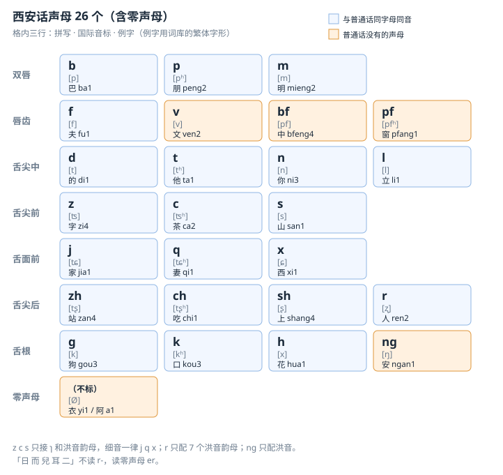
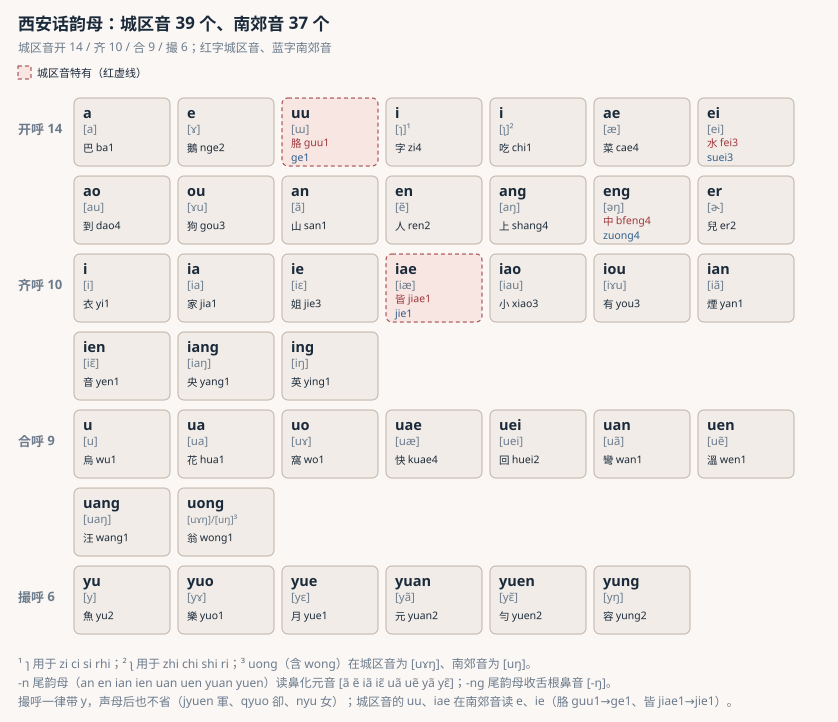
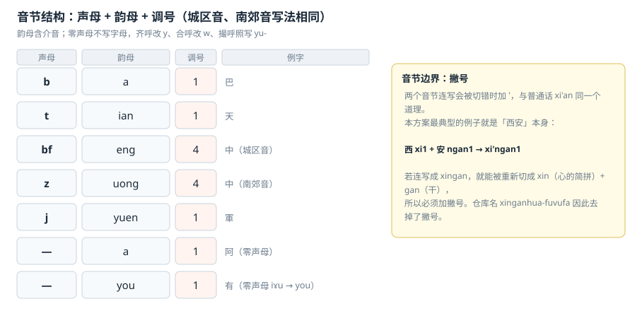
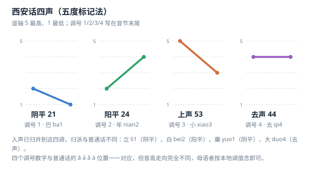
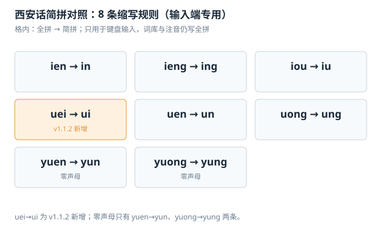
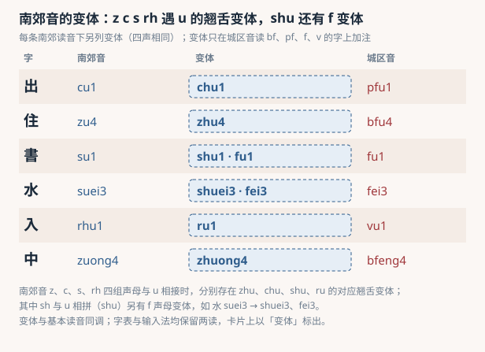

**简体中文** ｜ [繁體中文](README.zh-Hant.md) ｜ [English](README.en.md) ｜ [日本語](README.ja.md)

> **安卓直装包**：[android-xinganhua](https://github.com/SiqYin/android-xinganhua) —— 将西安话方案直接编进 Fcitx5 for Android（小企鹅输入法）的安装包，手机装上本体与 Rime 插件即可开打，免去手动导入词库之烦。

# 西安话输入法 · xinganhua-fuvufa

为 Rime 输入法平台整理的西安话（中原官话·关中片）拼音方案。仓内并行维护两套口音：**城区音**（`chengqyu`）与**南郊音**（`nanjiao`）。城区音字音取自 MCPDict 所收西安城区音档；南郊音以西安话、渭南话、华县话、临潼话等音档为底本逐字厘定，并经本地口音比对。





- **方案标识**：`chengqyu`（西安话城区音）、`nanjiao`（西安话南郊音）；仓库名 `xinganhua-fuvufa` 沿用早期拼写「西安话输入法」（西 `xi1` 安 `ngan1` 话 `hua4` ｜ 输 `fu1` 入 `vu1` 法 `fa1`）
- **字表规模**：城区音 3,649 条（3,346 字），南郊音 4,594 条（4,065 字，含渭南独有等增补字 720 个）
- **音系轮廓**：两支共用 24 声母、四个声调（阴平 31、阳平 24、上声 53、去声 55）；城区音 26 声母、39 韵母（含 `bf`、`pf` 与 `uu`、`iae`、`uong`），南郊音 25 声母、37 韵母（另立 `rh`，无 `uu`、`iae`，合口鼻尾韵直接拼作 `ung`）
- **适用前端**：小狼毫（Weasel）、鼠须管（Squirrel）、同文（Trime）、fcitx-rime 等 Rime 系列输入法
- **体例说明**：正文行文用简体，字音例字随词库保留繁体原字形（如 `鵝`、`軍`、`豬`、`來`、`溫`），便于直接与字典对照；顶部链接可切换简、繁、英、日四版说明

| 方案 | 名称 | 声母 | 韵母 | 字音表 |
|---|---|---|---|---|
| `chengqyu` | 西安话城区音 | 26（含 `bf`、`pf`） | 39（含 `uu`、`iae`、`uong`） | `chengqyu.word.dict.yaml`，3,649 条 |
| `nanjiao` | 西安话南郊音 | 25（含 `rh`） | 37（作 `ung`） | `nanjiao.word.dict.yaml`，4,594 条 |

---

## 目录

1. [方案缘起与记音方式](#s1)
2. [声母](#s2)
3. [韵母](#s3)
4. [声调](#s4)
5. [正字法细节](#s5)
6. [与普通话拼音的对照](#s6)
7. [常用字试打](#s7)
8. [输入端的简化拼写](#s8)
9. [词库与字表数据](#s9)
10. [文件清单与安装](#s10)
11. [转写复核与重生成](#s11)
12. [待定事项](#s12)
13. [音档来源与致谢](#s13)
14. [授权许可](#s14)

---

<a id="s1"></a>

## 一、方案缘起与记音方式

这套拼写直接称作**西安话拼音**，涵盖城内传统口音与城南郊区口音两套字表。一个音节由「声母 + 韵母 + 调号」构成，例如 `ba1` 巴、`jyuen1` 軍；「中」字城区读 `bfeng4`，南郊读 `zung4`。



城区音 3,649 条字音由转写脚本从国际音标自动折算，392 个不计调音节拼写彼此相异；南郊音 4,594 条折自逐字裁定表与两地一致读音，420 个不计调音节同样互不重形。拼写与音标一一对应，反查音值时不会产生歧义。

---

<a id="s2"></a>

## 二、声母

两支方言共用 24 个声母（23 辅音及零声母）。城区音多出唇齿塞擦音 `bf`、`pf`，共 26 个；南郊音多出浊舌尖前擦音 `rh`，共 25 个。按发音部位依次排作六组及零声母：

- **唇音**：`b [p]`、`p [pʰ]`、`m [m]`、`bf [pf]`（城区）、`pf [pfʰ]`（城区）、`f [f]`、`v [v]`
- **舌尖中音**：`d [t]`、`t [tʰ]`、`n [n]`、`l [l]`
- **舌根音**：`g [k]`、`k [kʰ]`、`h [x]`、`ng [ŋ]`
- **舌面前音**：`j [tɕ]`、`q [tɕʰ]`、`x [ɕ]`
- **舌尖后音**：`zh [ʈʂ]`、`ch [ʈʂʰ]`、`sh [ʂ]`、`r [ɻ]`
- **舌尖前音**：`z [ts]`、`c [tsʰ]`、`s [s]`、`rh [z]`（南郊）

配音规则如下（涉及 `bf`、`pf` 者仅限城区音，涉及 `rh` 者仅限南郊音）：

- **`n` 的细音条件变体**：`n` 与 `i`、`y` 起头的细音韵母相拼时，实际音值为 `[ȵ]`（如 `你 ni3`、`女 nyu3`）；配开口呼、合口呼时仍读 `[n]`（如 `南 nan2`、`挪 nuo2`）。
- **平舌与团音分工**：`z c s`（`[ts tsʰ s]`）只配 `[ɿ]` 及洪音韵母；遇 `i`、`y` 细音一律写作 `j q x`（`[tɕ tɕʰ ɕ]`）。
- **唇齿塞擦音 `bf`、`pf`**：城区音只配洪音与合口韵母（`bfu` 豬、`bfuo` 捉、`bfan` 磚、`pfang` 窗）。南郊音并入 `z`、`c` 并增生 `u` 介音：`zu` 豬、`zuo` 捉、`zuan` 磚、`cuang` 窗。
- **南郊特有 `rh`**：音值 `[z]`，只配合口韵母（`u ua uo uae uei uan uen ung`），对应城区音的 `v`：`入 vu1→rhu1`、`若 vuo1→rhuo1`、`軟 van3→rhuan3`、`潤 ven4→rhuen4`。
- **舌尖后擦音 `r`**：只配七个洪音韵母（`re` 熱、`rao` 饒、`ren` 人、`rou` 揉、`ran` 然、`rang` 瓤、`reng` 扔）；「日 而 兒 耳 二」读零声母 `er`。
- **舌根鼻音 `ng`**：只配洪音韵母（`nge` 鵝、`ngan` 安、`ngen` 恩、`ngang` 昂、`ngae` 哀、`ngei` 額、`ngao` 熬、`ngou` 歐）。
- **`v` 与 `f` 对立**：如 `ven` 文对 `fen` 分、`va` 襪对 `fa` 法。

---

<a id="s3"></a>

## 三、韵母

城区音有 39 个韵母（开 14 / 齐 10 / 合 9 / 撮 6），南郊音有 37 个韵母（开 13 / 齐 9 / 合 9 / 撮 6；无 `uu [ɯ]`、`iae [iæ]`，且合口鼻尾韵直接作 `ung [uŋ]`）：

- **开口呼（14）**：`a [a]`、`e [ɤ]`、`uu [ɯ]`（城区）、`i [ɿ]`（`zi ci si rhi`）、`i [ʅ]`（`zhi chi shi ri`）、`ae [æ]`、`ei [ei]`、`ao [au]`、`ou [ɤu]`、`an [ã]`、`en [ẽ]`、`ang [aŋ]`、`eng [əŋ]`、`er [ɚ]`
- **齐齿呼（10）**：`i [i]`、`ia [ia]`、`ie [iɛ]`、`iae [iæ]`（城区）、`iao [iau]`、`iou [iɤu]`、`ian [iã]`、`ien [iɛ̃]`、`iang [iaŋ]`、`ing [iŋ]`
- **合口呼（9）**：`u [u]`、`ua [ua]`、`uo [uɤ]`、`uae [uæ]`、`uei [uei]`、`uan [uã]`、`uen [uẽ]`、`uang [uaŋ]`、`uong [uɤŋ]`（城区）/ `ung [uŋ]`（南郊）
- **撮口呼（6）**：`yu [y]`、`yuo [yɤ]`、`yue [yɛ]`、`yuan [yã]`、`yuen [yɛ̃]`、`yung [yŋ]`

零声母拼写规律两支相同：

| 呼 | 零声母规则 | 例 |
|---|---|---|
| 开口呼 | 不加辅助字母 | `a` 阿、`er` 日、`ae`、`ao`、`an`、`ei`、`en`、`ou`、`ang`、`eng` |
| 齐齿呼 | `i` 改 `y` | `yi` 衣、`ya` 丫、`ye` 也、`yae` 涯、`yao` 耀、`you` 有、`yan` 煙、`yen` 音、`yang` 央、`ying` 英 |
| 合口呼 | `u` 改 `w` | `wu` 烏、`wa` 挖、`wo` 窩、`wae` 外、`wei` 威、`wan` 彎、`wen` 溫、`wang` 汪、`wong` 翁（城区）/ `wung` 翁（南郊） |
| 撮口呼 | 径写 `yu-` | `yu` 魚、`yuo` 樂、`yue` 月、`yuan` 冤、`yuen` 勻、`yung` 容 |

撮口呼前接声母时亦保留 `y`，如 `jyu` 居、`qyuo` 卻、`xyuen` 熏、`nyu` 女、`lyu` 律。城区音 `uu`（`guu` 胳）在南郊音读 `e`（`ge`），`iae`（`jiae` 皆）在南郊音读 `ie`（`jie`）。

---

<a id="s4"></a>

## 四、声调



四声调号紧附于音节末尾，不加空格。古入声字已全数归入四调，例如 `立 li1`（阴平）、`白 bei2`（阳平）、`藥 yuo1`（阴平）、`六 liou1`（阴平）、`十 shi2`（阳平）、`大 duo4`（去声）。

**连读变调**：两字相连时主要由前字变调，常见两类——两字皆为阴平（`31-31`）时，前字改读阳平（`24-31`）；两字皆为上声（`53-53`）时，前字改读阴平（`31-53`）。

---

<a id="s5"></a>

## 五、正字法细节

1. **舌尖元音**：`[ɿ]`（`z c s rh` 后）与 `[ʅ]`（`zh ch sh r` 后）统一记作 `i`，如 `zi` 指、`chi` 吃，依声母自然区分。
2. **鼻化韵与鼻尾韵**：拼作 `-n` 尾的韵母（`an en ian ien uan uen yuan yuen`）实际发鼻化元音 `[ã ẽ iã iɛ̃ uã uẽ yã yɛ̃]`，无舌尖鼻音收尾；拼作 `-ng` 尾的韵母（`ang eng iang ing uang`、城区 `uong` / 南郊 `ung`、`yung`）收舌根鼻音 `[-ŋ]`。城区音带 `[ɤ]` 过渡作 `uong [uɤŋ]`，南郊音实际即读 `[uŋ]`，拼写直接作 `ung`。
3. **音节分隔撇号**：连写会引发切分歧义时加 `'`，如「西安」作 `xi'ngan1`；若不加撇号，`xingan` 易被误切为 `xin`（简拼）+ `gan`。
4. **全拼注音与输入简拼分离**：对外标音及词典正文一律写全拼带调（如 `vuo1`、`ying1`、`yung2`）；输入端简拼与省调仅在按键阶段生效（见第八节）。

---

<a id="s6"></a>

## 六、与普通话拼音的对照

给习惯普通话拼音的读者作一速览：

**① 拼法与声母音值相近的**

`b p m f d t n l g k h z c s zh ch sh r j q x` 的清浊送气关系与普通话一致（`n` 逢细音读 `[ȵ]`）；`a i u e er ae ei ao ou ia ie iao ian iang ing ua uo uae uan uang` 等韵母的写法也基本吻合（如 `巴 ba1`、`天 tian1`、`小 xiao3`、`到 dao4`、`走 zou3`、`家 jia1`、`明 ming2`、`花 hua1`、`快 kuae4`、`光 guang1`、`窩 wo1`、`烏 wu1`、`衣 yi1`、`兒 er2`）。

**② 同形而音值有别的**

`-n` 尾各韵在西安话里都是鼻化元音而非鼻音尾：`山 san1`、`人 ren2`、`音 yen1`、`溫 wen1`。此外阴平为低降 `31`、去声为高平 `55`，与普通话调值差异较大。

**③ 拼法不同、需要留意的韵母**

| 普通话 | 西安话拼音（两音同） | 例 | 说明 |
|---|---|---|---|
| in | ien | 心 `xien1` | 全拼不省 `e`，输入端可简打 `in` |
| iu | iou | 牛 `niou2` | 全拼保留 `o`，输入端可简打 `iu` |
| ui | uei | 回 `huei2` | 全拼保留 `e`，输入端可简打 `ui` |
| un | uen | 溫 `wen1` | 零声母与普通话同作 `wen` |
| ong | 城区 `uong` / 南郊 `ung` | 東 `duong1` / `dung1` | 城区 `[uɤŋ]`（零声母 `wong`）、南郊 `[uŋ]`（零声母 `wung`） |
| iong | `yung` | 容 `yung2` | 撮口呼带 `y` |
| ü / üe / üan / ün | `yu / yue / yuan / yuen` | 魚 `yu2`、月 `yue1`、元 `yuan2`、軍 `jyuen1` | 声母后照写 `y`，不省略 |

**④ 城区音与南郊音独有的音位**

- 城区音另有 `bf`、`pf`（`豬 bfu1`、`窗 pfang1`）与 `uu`、`iae`（`胳 guu1`、`皆 jiae1`），南郊音作 `z/c` 增 `u` 介音（`zu1`、`cuang1`）与 `e/ie`（`ge1`、`jie1`）。
- 南郊音另有 `rh`（`入 rhu1`、`若 rhuo1`），城区音作 `v`（`vu1`、`vuo1`）。

**⑤ 声母分合不同的代表字**

| 普通话 | 城区音 | 南郊音 | 例字 |
|---|---|---|---|
| shuǐ | `fei3` | `suei3` | 水 |
| shū | `fu1` | `su1` | 書 |
| shuō | `she1` | `she1` | 說 |
| shān / shì | `san1 / si4` | `san1 / si4` | 山 / 是 |
| zhū / chū | `bfu1 / pfu1` | `zu1 / cu1` | 豬 / 出 |
| zhōng / chūn | `bfeng4 / pfen1` | `zung4 / cuen1` | 中 / 春 |
| wén | `ven2` | `ven2` | 文 |
| é / ān | `nge2 / ngan1` | `nge2 / ngan1` | 鵝 / 安 |
| rì | `er1` | `er1` | 日 |
| rù | `vu1` | `rhu1` | 入 |

---

<a id="s7"></a>

## 七、常用字试打

| 字 | 普通话 | 西安话码 | | 字 | 普通话 | 西安话码 |
|---|---|---|---|---|---|---|
| 我 | wǒ | `nge3` | | 魚 | yú | `yu2` |
| 你 | nǐ | `ni3` | | 軍 | jūn | `jyuen1` |
| 他 | tā | `ta1` | | 東 | dōng | `duong1` |
| 人 | rén | `ren2` | | 心 | xīn | `xien1` |
| 山 | shān | `san1` | | 明 | míng | `ming2` |
| 水 | shuǐ | `fei3` | | 有 | yǒu | `you3` |
| 中 | zhōng | `bfeng4` | | 不 | bù | `bu1` |
| 天 | tiān | `tian1` | | 是 | shì | `si4` |
| 家 | jiā | `jia1` | | 立 | lì | `li1` |
| 日 | rì | `er1` | | 大 | dà | `da4` |

上表按城区音列出；南郊音里「水」作 `suei3`、「中」作 `zung4`、「東」作 `dung1`，余皆相同。实际打字时不输调号，敲 `ba` 即出四声候选；反查普通话字音用反引号 `` ` `` 起头（如 `` `zhong ``，末尾 `;` 可省）。`q`、`x` 已作为西安话正式声母使用，故早先的笔画反查已撤除。

---

<a id="s8"></a>

## 八、输入端的简化拼写

### 8.1 韵母简拼（城区 9 条 · 南郊 8 条）

由于 `o` 韵母已并入 `uo`，输入端可安心将 `uo` 简写为 `o`；撮口的 `yuo` 在 `j q x` 之后也简写为 `o`（`j q x` 从不与 `uo` 相拼，二者不构成对立），零声母与 `n` 之后则写作 `yo`；而 `ing`、`yung` 已升为正式全拼，无需再做简拼规则。至于 `uong → ung`，**城区音中拼音可以这样简化，南郊音本来的拼写就是后者（`ung`）**，因此南郊方案不再另挂一条 `uong → ung` 简拼规则：

| 全拼 | 简拼 | 条件 | 例 |
|---|---|---|---|
| `ien` | `in` | 仅限前有辅音声母 | `jien` 今 → `jin`、`xien` 新 → `xin` |
| `iou` | `iu` | 仅限前有辅音声母 | `jiou` 究 → `jiu`、`niou` 牛 → `niu` |
| `uo` | `o` | 仅限前有辅音声母 | `duo` 多 → `do`、`vuo` 勿 → `vo` |
| `uei` | `ui` | 仅限前有辅音声母 | `huei` 回 → `hui`、`duei` 對 → `dui` |
| `uen` | `un` | 仅限前有辅音声母 | `suen` 孫 → `sun`、`duen` 墩 → `dun` |
| `uong` | `ung` | **仅城区音**（前有辅音声母） | 城区 `duong` 冬 → `dung`（南郊本即拼 `dung`） |
| `yuo` | `o` | 仅限 `j q x` 之后 | `jyuo` 覺 → `jo`、`qyuo` 卻 → `qo`、`xyuo` 學 → `xo` |
| `yuo` | `yo` | 零声母，以及 `n` 之后（`nuo` 与 `nyuo` 对立，不简作 `no`） | `yuo` 藥 → `yo`、`nyuo` 握 → `nyo` |
| `yuen` | `yun` | 含零声母一并放行 | `yuen` 勻 → `yun`、`jyuen` 軍 → `jyun` |





**南郊音变体**：南郊音 `z`、`c`、`s`、`rh` 接 `u` 韵母时，另有 `zh`、`ch`、`sh`、`r` 翘舌变体；其中 `sh` 拼 `u` 时另有 `f` 声母变体。变体只加注在城区音读 `bf`、`pf`、`f`、`v` 的字及审定的渭南独有字上（如「水」南郊作 `suei3`，另有变体 `shuei3`、`fei3`），与本读音同调，词库与字表一并保留。

**以下简写不予开放**（会与全拼或他音冲突）：

- `you 有 → yu`（撞 `魚 yu`）
- `yen 音 → in`、`wo 窩 → o`、`wei 威 → ui`、`wen 溫 → un`、城区 `wong` / 南郊 `wung` 翁 → `ung`（零声母维持全拼，以免破坏简拼无歧义约束）
- `yue`、`yuan`、`yu`、`yung`（未设简写）
- `qyo`、`jyo`、`xyo`（旧写法，已由 `qo`、`jo`、`xo` 取代；`n` 后的 `nyo` 保留）

### 8.2 不输入声调

数字 `1`–`9` 留给候选翻页与选词，`speller/algebra` 通过 `xform/\d//` 剥除声调，调号只在候选右侧的注音提示中保留。

### 8.3 冲突校验

经 `librime` 真机与脚本全量检验，城区音 392 个音节与南郊音 420 个音节在各自简拼展开后，**跨音节歧义均为 0**，简拼码亦不与任何合法全拼重形。

---

<a id="s9"></a>

## 九、词库与字表数据

| 项 | 城区音 | 南郊音 |
|---|---|---|
| 字音条目（一字一音一行） | 3,649 | 4,594 |
| 不同汉字 | 3,346 | 4,065（含渭南独有等增补 720 字） |
| 多音字 | 275 | 428（不含变体 256） |
| 分调条目 1/2/3/4 | 1,149 / 826 / 639 / 1,035 | 1,431 / 1,044 / 842 / 1,271（另轻声 6） |

词库每行严格遵守 `汉字<TAB>全拼+调号` 格式。校表可重点留意源表自带的同字多音（如 `勻 yen2 / yuen2`、`你 ni1 / ni3`、`不 bu1 / bu2`、`來 lae1 / lae2`、`大 da4 / duo4`、`行 hang2 / hang4 / xing2`）。另有 3 个源表记为有音无字（`□`）的音节未收进词库：`zou2`（~幹：精幹）、`tae3`（打~：赌木柴游戏）、`sao2`（用鞭梢打）。

---

<a id="s10"></a>

## 十、文件清单与安装

```
chengqyu.schema.yaml           西安话城区音方案（字母表、简拼演算、` 反查）
chengqyu.dict.yaml             城区音主词典，导入 chengqyu.word
chengqyu.word.dict.yaml        城区音字音表（脚本生成，勿手改）
nanjiao.schema.yaml            西安话南郊音方案
nanjiao.dict.yaml              南郊音主词典，导入 nanjiao.word
nanjiao.word.dict.yaml         南郊音字音表（脚本生成，勿手改）
figures/*.svg                  六张配图 × 简 / 繁 / 英 / 日共 24 个文件
tools/ipa2pinyin.mjs           IPA → 城区音拼音转写脚本
tools/make_nanjiao_dict.py     南郊音字表 → nanjiao.word.dict.yaml
tools/make-figures.mjs         配图生成脚本
tools/chengqyu.ipa對照.tsv    城区音逐音对照表
tools/chengqyu.詳注.tsv       城区音逐字详注表
```

安装步骤：

1. 将六个 `.yaml` 文件放进 Rime 用户目录（Windows 小狼毫 `%APPDATA%\Rime`、macOS 鼠须管 `~/Library/Rime`、Linux `~/.config/ibus/rime` 或 `~/.local/share/fcitx5/rime`）。
2. 在 `default.custom.yaml` 的 `schema_list` 下挂上 `chengqyu` 与 `nanjiao`。
3. 重新部署即可使用。

---

<a id="s11"></a>

## 十一、转写复核与重生成

城区音转写规则集中于 `tools/ipa2pinyin.mjs`，修改后在仓库根目录运行：

```sh
node tools/ipa2pinyin.mjs /path/to/西安.tsv
```

南郊音字表更新后运行 `python tools/make_nanjiao_dict.py`，配图更新后运行 `node tools/make-figures.mjs` 一次生成 24 张 SVG。

---

<a id="s12"></a>

## 十二、待定事项

1. **撮呼 `y` 的写法**：现行 `jyu/qyuo/xyuen/nyu/lyu`，`chengqyu.schema.yaml` 与 `nanjiao.schema.yaml` 内已预留普通话式 `ju/qu/xu/nü/lü` 兼容规则注释，视后续习惯决定是否启用。
2. **零声母 `yen`**：机械由 `i→y` 规则得出；普通话式 `yin` 会与简拼 `in`（对应 `ien`）冲突，故仍作 `yen`。
3. **词组词库与字频权重**：目前暂借 `use_preset_vocabulary` 的通用词频，后续待字音全部定稿后再批量折叠无多音字词组并自建词频与 `.gram` 模型。
4. `reverse_lookup_translator` 为保持与 `wugniu_suwu` 写法一致暂沿用旧名，若新版 librime 提示弃用再行切换。

---

<a id="s13"></a>

## 十三、音档来源与致谢

- [西安话音档](https://github.com/osfans/MCPDict/blob/master/tools/tables/data/%E8%A5%BF%E5%AE%89.tsv)、[渭南话音档](https://github.com/osfans/MCPDict/blob/master/tools/tables/data/%E6%B8%AD%E5%8D%97.tsv)、[华县话音档](https://github.com/osfans/MCPDict/blob/master/tools%2Ftables%2Fdata%2F%E5%8D%8E%E5%8E%BF.tsv)、[临潼话音档](https://github.com/osfans/MCPDict/blob/master/tools%2Ftables%2Fdata%2F%E4%B8%B4%E6%BD%BC%E6%96%B9%E8%A8%80%E8%AF%AD%E9%9F%B3%E7%A0%94%E7%A9%B6.tsv) —— 均出自 [osfans/MCPDict](https://github.com/osfans/MCPDict)；西安话音档即城区音字音来源，其余三档为南郊音整理参照。
- **南郊话音档**无现成成表可循，系在西安话、渭南话、临潼话、华县话等音档底本上，参考知乎关于南郊、东郊平翘舌分合的讨论，并与本人及家人日常读音逐字核对整理而成，**仅供参考**。
- [wugniu_suwu](https://github.com/SiqYin/wugniu_suwu) 与 [bepemefeve_flypy](https://github.com/SiqYin/bepemefeve_flypy) —— 本方案配置结构、图例版式与文档体例的参照。

---

<a id="s14"></a>

## 十四、授权许可

本仓库方案文件、配图与说明文档可自由使用、修改与再分发。字音数据来自 MCPDict，版权与许可请遵循原项目规定。
