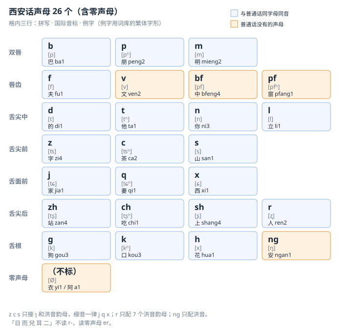
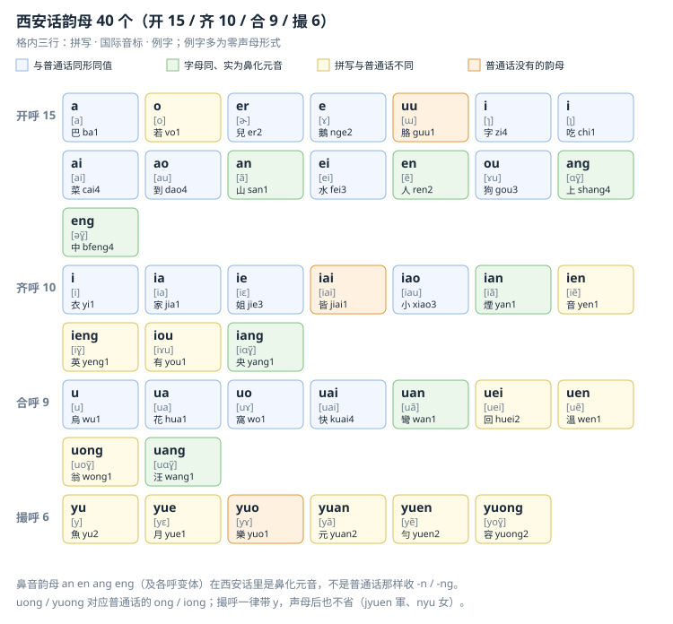
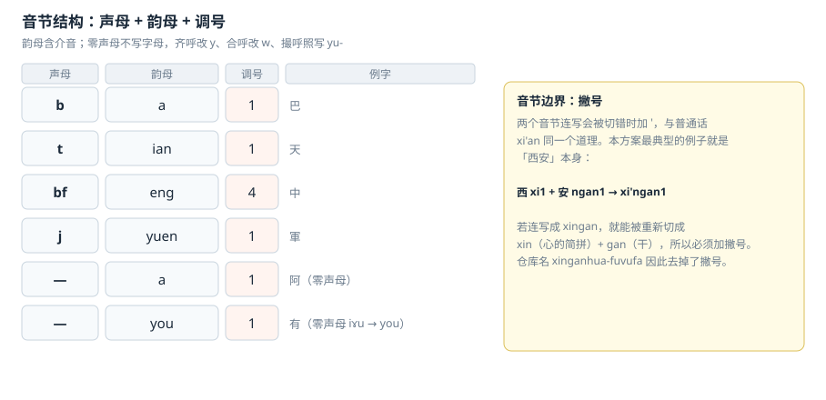
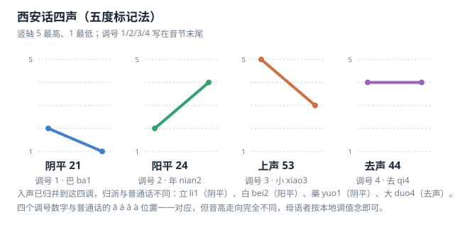

# 西安话输入法 · xinganhua-fuvufa

> 用**西安话拼音**（全拼 + 调号 1/2/3/4）在 Rime 里打西安话。字音逐条来自 [osfans/MCPDict《西安》数据表](https://github.com/osfans/MCPDict/blob/master/tools/tables/data/%E8%A5%BF%E5%AE%89.tsv)（国际音标），转写零同形冲突。





- **方案代码**：`xinganhua`（仓库名 `xinganhua-fuvufa` = 本方案拼写的「西安话输入法」：西 xi1 安 ngan1 话 hua4 ｜ 输 fu1 入 vu1 法 fa1）
- **字表**：3,648 条字音 / 3,345 字头 / 275 个多音字；392 个不计调音节、1,158 个计调音节
- **音系**：声母 26（含零声母）、韵母 40、四声（阴平 21、阳平 24、上声 53、去声 44）
- **适用**：Rime 系输入法（小狼毫 Weasel / 鼠须管 Squirrel / Trime / fcitx-rime 等）
- **正文用简体**；表格里的例字保持词库的繁体字形（鵝、軍、豬、來、溫……），因为那是要能对上词库的数据

---

## 目录

1. [这个方案是什么](#一这个方案是什么)
2. [声母](#二声母)
3. [韵母](#三韵母)
4. [声调](#四声调)
5. [正字法细则](#五正字法细则)
6. [与普通话拼音的异同](#六与普通话拼音的异同)
7. [快速上手](#七快速上手)
8. [允许的简化拼写](#八允许的简化拼写)
9. [词库与字表](#九词库与字表)
10. [文件与安装](#十文件与安装)
11. [复核办法](#十一复核办法)
12. [待定与后续](#十二待定与后续)
13. [数据与致谢](#十三数据与致谢)
14. [授权](#十四授权)

---

## 一、这个方案是什么

西安话（陕西方言·关中片）的拼音输入方案。拼写系统就是**西安话拼音**，不另立名目：一个音节写成「声母 + 韵母 + 调号」，例如 `ba1 巴`、`bfeng4 中`、`jyuen1 軍`。



字表 3,648 条字音全部由脚本从 MCPDict 的国际音标逐条转写而来，转写后 392 个音节的拼写**两两不同（零同形冲突）**，也就是说这套罗马字是可逆的：拿拼音能原样还原成音标。

---

## 二、声母

26 个声母（25 个辅音 + 零声母），见文首的声母图。分布上的几条硬规则（只描述本表的共时分布，不做音类考证）：

- `z c s`（ʦ ʦʰ s）只接 `ɿ` 和洪音韵母；细音（i、y 起头）一律 `j q x`（ʨ ʨʰ ɕ）。这一点跟普通话一样：z c s 后面本来也不会跟 i、y 打头的韵母。
- `bf pf`（pf pfʰ）只出现在合口/洪音韵母前：`bfu 豬`、`bfuo 捉`、`bfan 磚`、`pfang 窗`。
- `r`（ʐ）只配 7 个洪音韵母：`re 熱`、`rao 饒`、`ren 人`、`rou 揉`、`ran 然`、`rang 瓤`、`reng 扔`；「日 而 兒 耳 二」不读 r-，读零声母 `er`。
- `ng`（ŋ）只配洪音：`nge 我`、`ngan 安`、`ngen 恩`、`ngang 昂`、`ngai 哀`、`ngei 額`、`ngao 熬`、`ngou 歐`。
- `v` 与 `f` 对立：`ven 文` ⟂ `fen 分`、`va 襪` ⟂ `fa 法`。

---

## 三、韵母

40 个韵母（开 15 / 齐 10 / 合 9 / 撮 6），见文首的韵母图。零声母的写法：

| 呼 | 零声母规则 | 例 |
|---|---|---|
| 开呼 | 不加字母 | `a 阿 a1`、`er 日 er1`、`ai`、`ao`、`an`、`ei`、`en`、`ou`、`ang`、`eng` |
| 齐呼 | `i` 改 `y` | `i→yi 衣`、`ia→ya 丫`、`ie→ye 也`、`ian→yan 煙`、`ien→yen 音`、`ieng→yeng 英`、`iou→you 有`、`iang→yang 央` |
| 合呼 | `u` 改 `w` | `u→wu 烏`、`ua→wa 挖`、`uo→wo 窩`、`uai→wai 外`、`uan→wan 彎`、`uei→wei 威`、`uen→wen 溫`、`uong→wong 翁`、`uang→wang 汪` |
| 撮呼 | 照写 `yu-` | `yu 魚`、`yue 月`、`yuo 樂`、`yuan 冤`、`yuen 勻`、`yuong 容` |

撮呼一律带 `y`，声母后也不省：`jyu 居`、`qyuo 卻`、`xyuen 熏`、`nyu 女`、`lyu 律`。

---

## 四、声调



调号紧跟在音节后，不另加空格。入声已归并到这四个调里，归派与普通话不同：`立 li1`（阴平，普通话去声）、`白 bei2`（阳平，普通话阳平）、`藥 yuo1`（阴平，普通话去声）、`六 liou1`（阴平，普通话去声）、`十 shi2`（阳平，普通话阳平）、`大 duo4`（去声，普通话去声）。

---

## 五、正字法细则

1. **舌尖元音**：`ɿ`（z c s 后）、`ʅ`（zh ch sh r 后）都写 `i`，靠声母限定不会混：`zi 指`、`chi 吃`。与普通话的 `zi ci si / zhi chi shi` 写法一致。
2. **鼻音韵母**：`ã ẽ ɑɣ̃ əɣ̃` 及各呼变体一律写成 `n/ŋ` 尾（`an en ang eng`、`ian ien ieng iang`、`uan uen uong uang`、`yuan yuen yuong`）。注意 `uong`/`yuong` 对的是 `uoɣ̃`/`yoɣ̃`，跟普通话的 `ong/iong` 不同形。
3. **音节边界用撇号**：两音节连写会被切错时加 `'`，与普通话 `xi'an` 同一个道理。本方案最典型的例子就是「西安」本身：`xi1 + ngan1 → xi'ngan1`；若连写成 `xingan`，就能被重新切成 `xin`（心的简拼）+ `gan`（干）。仓库名因此去掉了撇号。
4. **对外注音永远带调**，词库行也是带调全拼；简拼与省调只存在于输入端（见第八节）。

---

## 六、与普通话拼音的异同

面向会普通话拼音的人：字母系统大体相同，差别集中在少数声母、少数韵母的拼写、以及调值上。

**① 完全一样的（直接照打）**

`b p m f d t n l g k h z c s zh ch sh r j q x` 这些声母字母与读音跟普通话一致（不送气/送气关系也一致）；`a i u e er ai ei ao ou ia ie iao ian iang ua uo uai uan uang` 这些韵母拼写也一致。例：`巴 ba1`、`天 tian1`、`小 xiao3`、`到 dao4`、`走 zou3`、`家 jia1`、`花 hua1`、`快 kuai4`、`光 guang1`、`窩 wo1`、`烏 wu1`、`衣 yi1`、`兒 er2`。零声母的 y/w 规则与普通话完全相同。

**② 字母相同、音值不同（形同音异）**

所有 `-n / -ng` 结尾的韵母在西安话里是**鼻化元音**，不是普通话那样收鼻音尾：`an = ã`、`en = ẽ`、`ang = ɑɣ̃`、`eng = əɣ̃`。所以 `山 san1`、`人 ren2`、`上 shang4`、`中 bfeng4` 的字母跟普通话一样，念法不一样。

**③ 拼写不同（要重记的）**

| 普通话 | 西安话拼音 | 例 | 说明 |
|---|---|---|---|
| in | ien | 心 xien1 | 全拼不简；输入时可简拼 in |
| ing | ieng | 明 mieng2 | 同上 |
| iu | iou | 牛 niou2 | 同上 |
| ui | uei | 回 huei2 | 不简写 |
| un | uen | 溫 wen1 | 零声母时与普通话同形 wen |
| ong | uong | 東 duong1 | 零声母 wong 翁 |
| iong | yuong | 容 yuong2 | 撮呼带 y |
| ü / üe / üan / ün | yu / yue / yuan / yuen | 魚 yu2、月 yue1、元 yuan2、軍 jyuen1 | 一律带 y，声母后也不省 |

**④ 西安话多出来的**

- 声母：`bf pf`（豬 bfu1、窗 pfang1）、`v`（文 ven2）、`ng`（安 ngan1）
- 韵母：`uu`（胳 guu1）、`o`（只在 `vo`：若 vo1）、`iai`（皆 jiai1）、`yuo`（樂 yuo1）

**⑤ 声母对不上的字（记例不记规则）**

| 普通话 | 西安话拼音 | 例 |
|---|---|---|
| shuǐ | fei3 | 水 |
| shū | fu1 | 書 |
| shuō | she1 | 說 |
| shān / shì | san1 / si4 | 山 / 是 |
| zhū / chū | bfu1 / pfu1 | 豬 / 出 |
| zhōng / chūn | bfeng4 / pfen1 | 中 / 春 |
| wén | ven2 | 文 |
| é / ān | nge2 / ngan1 | 鵝 / 安 |
| rì | er1 | 日 |

**⑥ 调号位置一样、调值完全不同**：普通话的 ā á ǎ à 对应本方案的 1 2 3 4，但西安话是 21 / 24 / 53 / 44（见声调图）。母语者按本地调值念即可，不需要换算。

---

## 七、快速上手

| 字 | 普通话 | 西安话码 | | 字 | 普通话 | 西安话码 |
|---|---|---|---|---|---|---|
| 我 | wǒ | `nge3` | | 魚 | yú | `yu2` |
| 你 | nǐ | `ni3` | | 軍 | jūn | `jyuen1` |
| 他 | tā | `ta1` | | 東 | dōng | `duong1` |
| 人 | rén | `ren2` | | 心 | xīn | `xien1` |
| 山 | shān | `san1` | | 明 | míng | `mieng2` |
| 水 | shuǐ | `fei3` | | 有 | yǒu | `you3` |
| 中 | zhōng | `bfeng4` | | 不 | bù | `bu1` |
| 天 | tiān | `tian1` | | 是 | shì | `si4` |
| 家 | jiā | `jia1` | | 立 | lì | `li1` |
| 日 | rì | `er1` | | 大 | dà | `da4` |

- 调号可省：打 `ba` 出四个调的候选，打 `ba1` 只出阴平。
- 常用简拼：`in / ing / iu / un / ung / yun / yung` 分别对应 `ien / ieng / iou / uen / uong / yuen / yuong`（零声母的 `you 有`、`wen 溫` 不简）。
- 反查：`q` + 普通话拼音、`x` + 笔画，候选注释会显示西安话读音。

---

## 八、允许的简化拼写

### 8.1 韵母简拼（只在输入端兼容，词库与注音仍写全拼）

| 全拼 | 简拼 | 条件 | 例 |
|---|---|---|---|
| `ien` | `in` | 仅限前面有声母 | `jien 今 → jin`、`xien 新 → xin` |
| `ieng` | `ing` | 仅限前面有声母 | `mieng 明 → ming`、`xieng 行 → xing` |
| `iou` | `iu` | 仅限前面有声母 | `jiou 究 → jiu`、`niou 牛 → niu` |
| `uen` | `un` | 仅限前面有声母 | `suen 孫 → sun`、`duen 墩 → dun` |
| `uong` | `ung` | 仅限前面有声母 | `duong 冬 → dung`、`huong 烘 → hung` |
| `yuen` | `yun` | 零声母也放行 | `yuen 勻 → yun`、`jyuen 軍 → jyun` |
| `yuong` | `yung` | 零声母也放行 | `yuong 容 → yung`、`qyuong 瓊 → qyung` |

**不允许的简写**（会撞车或造出方案外的码）：

| 想简 | 结果 | 为什么不行 |
|---|---|---|
| `you 有` → `yu` | ✗ | 与 `魚 yu` 同形 |
| `wen 溫` → `wn`／`wun` | ✗ | 方案里没有这种切分 |
| `yen 音`、`yeng 英` → `in`、`ing` | ✗ | 零声母不简，`in` 只能指向 `ien` |
| `wong 翁` → `ung` | ✗ | 同上，`wong` 保持全拼 |
| `yue`、`yuo`、`yuan`、`yu` | 不简 | 本表未定简写式 |
| 声母只打首字母 | 暂不开放 | 单字层面同音太多，等词库做齐再启 `abbrev` |

放行条件在 `xinganhua.schema.yaml` 的 `speller/algebra` 里用声母锚点表达，不能图省事写成裸规则：`derive/uen/un/` 会把 `yuong`、`yuen` 这类零声母全拼也咬穿，产出错码。

### 8.2 声调可省

`alphabet` 收了 `1234`，调号是输入码的一部分，同时 algebra 生成去调变体。多音节要么全打调、要么全省，混打（`ba1 da`）不支持。

### 8.3 简拼歧义校验

把 algebra 全部规则跑在 392 个音节上：衍生 48 个简拼码（去调形式），**跨音节歧义 0 个**，简拼码与其他音节的全拼同形 0 个。简拼只增加输入宽容度，不会让一个码出两批不相干的字。

---

## 九、词库与字表

| 项 | 数 |
|---|---|
| 字音条目 | 3,648（一字一音一行） |
| 不同汉字 | 3,345 |
| 多音字 | 275（`着` 占 5 行、`卡` 占 4 行、`側` 占 3 行……） |
| 分调条目 | 1/2/3/4 = 1,148 / 826 / 639 / 1,035 |

- 词库严格 `字<TAB>单音节`，码列从不出现空格，免得被 Rime 当成多音节词组。
- 源表自带的同字又音，校表时重点看：`勻 yen2 / yuen2`、`你 ni1 / ni3`、`不 bu1 / bu2`、`來 lai1 / lai2`、`大 da4 / duo4`、`行 hang2 / hang4 / xieng2`。
- 有音无字（源表只给 `□`，未进词库）：`zou2`「~幹：精幹」、`tai3`「打~：赌木柴游戏」、`sao2`「用鞭梢打」。
- 用字是繁体（源表如此），简体输出要靠 opencc。

---

## 十、文件与安装

```
xinganhua.schema.yaml          方案：输入字母表、简拼演算、反查 Q/X
xinganhua.dict.yaml            主词典，导入 xinganhua.word
xinganhua.word.dict.yaml       字音表 3,648 条（脚本生成，勿手改）
onsets.svg / rhymes.svg        声母图 / 韵母图（脚本生成）
tones.svg / syllable.svg       声调图 / 音节结构图（脚本生成）
tools/ipa2pinyin.mjs           IPA → 西安话拼音转写脚本
tools/make-figures.mjs         四张 SVG 图的生成脚本
tools/xinganhua.ipa對照.tsv    逐音对照：IPA / 调名 / 拼音 / 声母 / 韵母 / 辖字
tools/xinganhua.詳注.tsv       逐字详注，含源表 {} 释义与白读标记
```

（两张对照表的文件名沿用繁体写法，与仓库里实际文件名一致。）

1. 把下列文件放进 Rime 用户目录
   - Windows（小狼毫）：`%APPDATA%\Rime`
   - macOS（鼠须管）：`~/Library/Rime`
   - Linux：`~/.config/ibus/rime` 或 `~/.local/share/fcitx5/rime`

   ```
   xinganhua.schema.yaml
   xinganhua.dict.yaml
   xinganhua.word.dict.yaml
   ```

2. 在 `default.custom.yaml` 里挂上方案：

   ```yaml
   patch:
     schema_list:
       - schema: xinganhua
       # 其他方案照样往下追加即可
   ```

3. 重新部署（小狼毫：右键托盘图标 →「重新部署」）。

---

## 十一、复核办法

转写规则全部集中在 `tools/ipa2pinyin.mjs` 顶部三张映射表（`MR` 声母、`FR` 韵母、`ZR` 零声母）。改完在仓库根目录跑：

```sh
node tools/ipa2pinyin.mjs /path/to/西安.tsv
```

词库与两张对照表一起重生，脚本自报：未映射音节、同形冲突、不含调/含调音节数、字音条目与多音字数。四张图用 `node tools/make-figures.mjs` 重生。algebra 的简拼衍生码另可写个模拟器逐条跑 schema 里的规则，检查歧义（开发时用过，未随仓库发布，需要可以再补进来）。

---

## 十二、待定与后续

1. **撮呼 `y` 是否保留**：现行 `jyu/qyuo/xyuen/nyu/lyu`；普通话式 `ju/qu/xu/nü/lü` 的兼容规则已在 schema 注释里预留。
2. **零声母 `yen/yeng`**：机械 `i→y` 的结果。普通话式 `yin/ying` 会与简拼 `in/ing` 撞车，故未采。
3. **词组库**：按「词中每字只有一个读音」批量折算，多音字词条人工裁音；这一步做完才谈得上句子输入体验。
4. **字频权重**：现在借 `use_preset_vocabulary` 用普通话词频，是临时的。
5. **语法模型**：`.gram` 未建，`contextual_suggestions` 暂关。
6. `reverse_lookup_translator` 在新版 librime 里属旧式写法，先与 wugniu_suwu 保持一致，部署报错再换。

---

## 十三、数据与致谢

- [osfans/MCPDict](https://github.com/osfans/MCPDict)（`tools/tables/data/西安.tsv`）——字音数据源，国际音标
- [wugniu_suwu](https://github.com/SiqYin/wugniu_suwu)（雪萤）——方案架构、词典组织方式与反查写法
- [bepemefeve_flypy](https://github.com/SiqYin/bepemefeve_flypy)（雪萤）——本 README 的排版与配图方式参照

**验证**：字表 3,648 条与原表逐字比对无一缺失；392 个音节拼写两两不同；algebra 简拼衍生码跨音节歧义 0。

---

## 十四、授权

方案配置（`xinganhua.schema.yaml`、四张 SVG、本说明）可自由使用、修改、再分发。字音数据来自 MCPDict《西安》数据表，版权与授权请遵循原项目说明。

---

## 声明

本 README 的全部内容由 Qoder 平台下的 Qwen 模型撰写输出。
