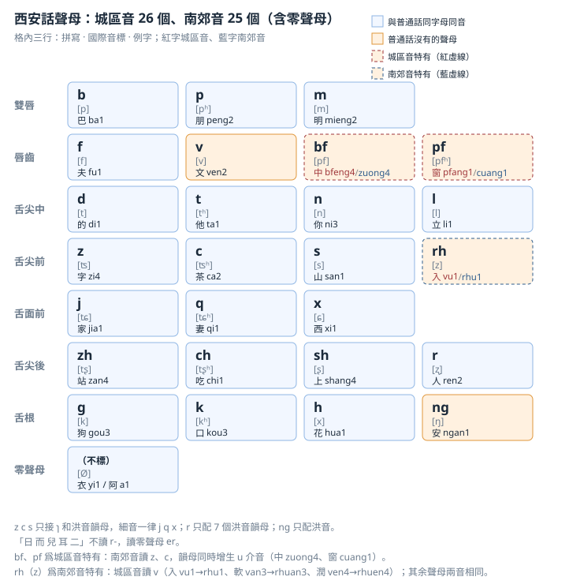
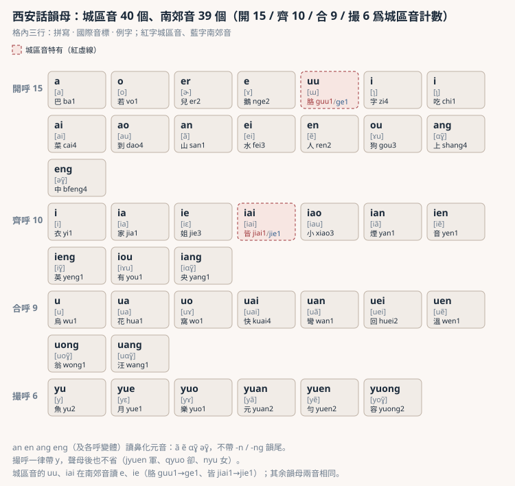
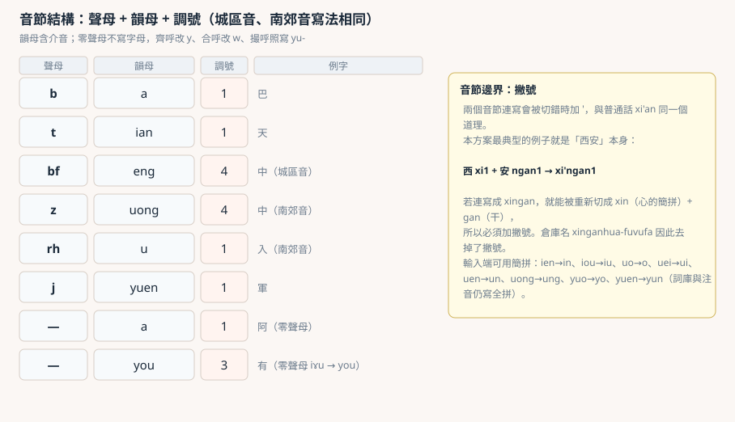
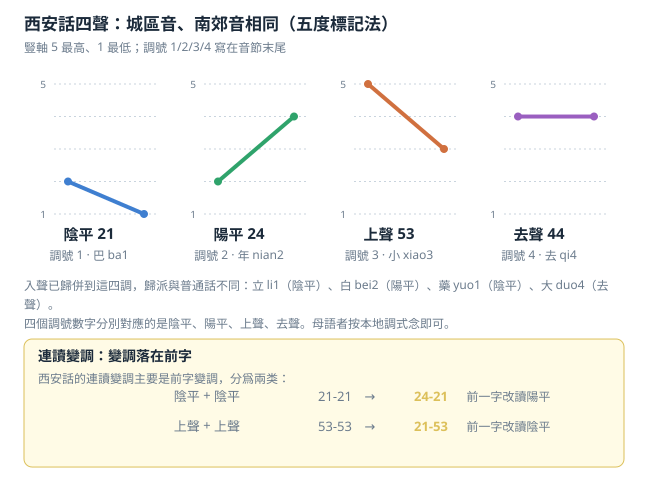
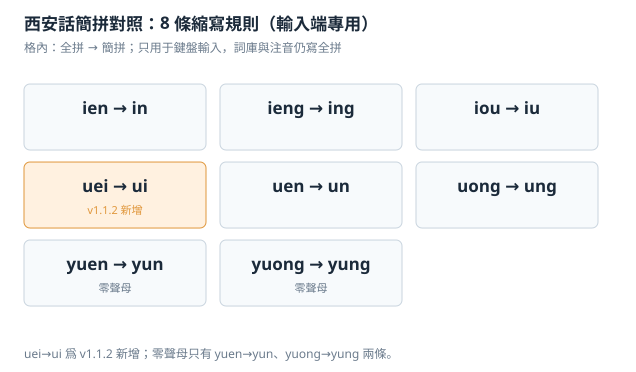
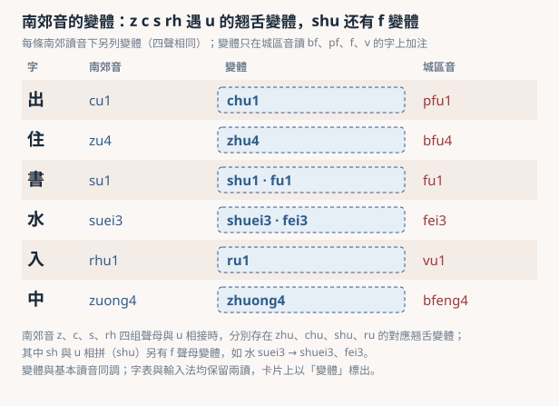

[简体中文](README.md) ｜ **繁體中文** ｜ [English](README.en.md) ｜ [日本語](README.ja.md)

> **安卓直裝包**：[android-xinganhua](https://github.com/SiqYin/android-xinganhua) —— 將西安話方案直接編進 Fcitx5 for Android（小企鵝輸入法）的安裝包，手機裝上本體與 Rime 插件即可開打，免去手動導入詞庫之煩。

# 西安話輸入法 · xinganhua-fuvufa

爲 Rime 輸入法平臺整理的西安話（中原官話·關中片）拼音方案。倉內並行維護兩套口音：**城區音**（`chengqyu`）與**南郊音**（`nanjiao`）。城區音字音取自 MCPDict 所收西安城區音檔；南郊音以西安話、渭南話、華縣話、臨潼話等音檔爲底本逐字釐定，並經本地口音比對。





- **方案標識**：`chengqyu`（西安話城區音）、`nanjiao`（西安話南郊音）；倉庫名 `xinganhua-fuvufa` 沿用早期拼寫「西安話輸入法」（西 `xi1` 安 `ngan1` 話 `hua4` ｜ 輸 `fu1` 入 `vu1` 法 `fa1`）
- **字表規模**：城區音 3,649 條（3,346 字），南郊音 4,594 條（4,065 字，含渭南獨有等增補字 720 個）
- **音系輪廓**：兩支共用 24 聲母、四個聲調（陰平 31、陽平 24、上聲 53、去聲 55）；城區音 26 聲母、39 韻母（含 `bf`、`pf` 與 `uu`、`iae`、`uong`），南郊音 25 聲母、37 韻母（另立 `rh`，無 `uu`、`iae`，合口鼻尾韻直接拼作 `ung`）
- **適用前端**：小狼毫（Weasel）、鼠須管（Squirrel）、同文（Trime）、fcitx-rime 等 Rime 系列輸入法
- **體例說明**：本頁繁體版由 OpenCC 自簡體原文轉出，字音例字隨詞庫保留繁體原字形（如 `鵝`、`軍`、`豬`、`來`、`溫`），便於直接與字典對照；頂部鏈接可切換簡、繁、英、日四版說明

| 方案 | 名稱 | 聲母 | 韻母 | 字音表 |
|---|---|---|---|---|
| `chengqyu` | 西安話城區音 | 26（含 `bf`、`pf`） | 39（含 `uu`、`iae`、`uong`） | `chengqyu.word.dict.yaml`，3,649 條 |
| `nanjiao` | 西安話南郊音 | 25（含 `rh`） | 37（作 `ung`） | `nanjiao.word.dict.yaml`，4,594 條 |

---

## 目錄

1. [方案緣起與記音方式](#s1)
2. [聲母](#s2)
3. [韻母](#s3)
4. [聲調](#s4)
5. [正字法細節](#s5)
6. [與普通話拼音的對照](#s6)
7. [常用字試打](#s7)
8. [輸入端的簡化拼寫](#s8)
9. [詞庫與字表數據](#s9)
10. [文件清單與安裝](#s10)
11. [轉寫複覈與重生成](#s11)
12. [待定事項](#s12)
13. [音檔來源與致謝](#s13)
14. [授權許可](#s14)

---

<a id="s1"></a>

## 一、方案緣起與記音方式

這套拼寫直接稱作**西安話拼音**，涵蓋城內傳統口音與城南郊區口音兩套字表。一個音節由「聲母 + 韻母 + 調號」構成，例如 `ba1` 巴、`jyuen1` 軍；「中」字城區讀 `bfeng4`，南郊讀 `zung4`。



城區音 3,649 條字音由轉寫腳本從國際音標自動折算，392 個不計調音節拼寫彼此相異；南郊音 4,594 條折自逐字裁定表與兩地一致讀音，420 個不計調音節同樣互不重形。拼寫與音標一一對應，反查音值時不會產生歧義。

---

<a id="s2"></a>

## 二、聲母

兩支方言共用 24 個聲母（23 輔音及零聲母）。城區音多出脣齒塞擦音 `bf`、`pf`，共 26 個；南郊音多出濁舌尖前擦音 `rh`，共 25 個。按發音部位依次排作六組及零聲母：

- **脣音**：`b [p]`、`p [pʰ]`、`m [m]`、`bf [pf]`（城區）、`pf [pfʰ]`（城區）、`f [f]`、`v [v]`
- **舌尖中音**：`d [t]`、`t [tʰ]`、`n [n]`、`l [l]`
- **舌根音**：`g [k]`、`k [kʰ]`、`h [x]`、`ng [ŋ]`
- **舌面前音**：`j [tɕ]`、`q [tɕʰ]`、`x [ɕ]`
- **舌尖後音**：`zh [ʈʂ]`、`ch [ʈʂʰ]`、`sh [ʂ]`、`r [ɻ]`
- **舌尖前音**：`z [ts]`、`c [tsʰ]`、`s [s]`、`rh [z]`（南郊）

配音規則如下（涉及 `bf`、`pf` 者僅限城區音，涉及 `rh` 者僅限南郊音）：

- **`n` 的細音條件變體**：`n` 與 `i`、`y` 起頭的細音韻母相拼時，實際音值爲 `[ȵ]`（如 `你 ni3`、`女 nyu3`）；配開口呼、合口呼時仍讀 `[n]`（如 `南 nan2`、`挪 nuo2`）。
- **平舌與團音分工**：`z c s`（`[ts tsʰ s]`）只配 `[ɿ]` 及洪音韻母；遇 `i`、`y` 細音一律寫作 `j q x`（`[tɕ tɕʰ ɕ]`）。
- **脣齒塞擦音 `bf`、`pf`**：城區音只配洪音與合口韻母（`bfu` 豬、`bfuo` 捉、`bfan` 磚、`pfang` 窗）。南郊音併入 `z`、`c` 並增生 `u` 介音：`zu` 豬、`zuo` 捉、`zuan` 磚、`cuang` 窗。
- **南郊特有 `rh`**：音值 `[z]`，只配合口韻母（`u ua uo uae uei uan uen ung`），對應城區音的 `v`：`入 vu1→rhu1`、`若 vuo1→rhuo1`、`軟 van3→rhuan3`、`潤 ven4→rhuen4`。
- **舌尖後擦音 `r`**：只配七個洪音韻母（`re` 熱、`rao` 饒、`ren` 人、`rou` 揉、`ran` 然、`rang` 瓤、`reng` 扔）；「日 而 兒 耳 二」讀零聲母 `er`。
- **舌根鼻音 `ng`**：只配洪音韻母（`nge` 鵝、`ngan` 安、`ngen` 恩、`ngang` 昂、`ngae` 哀、`ngei` 額、`ngao` 熬、`ngou` 歐）。
- **`v` 與 `f` 對立**：如 `ven` 文對 `fen` 分、`va` 襪對 `fa` 法。

---

<a id="s3"></a>

## 三、韻母

城區音有 39 個韻母（開 14 / 齊 10 / 合 9 / 撮 6），南郊音有 37 個韻母（開 13 / 齊 9 / 合 9 / 撮 6；無 `uu [ɯ]`、`iae [iæ]`，且合口鼻尾韻直接作 `ung [uŋ]`）：

- **開口呼（14）**：`a [a]`、`e [ɤ]`、`uu [ɯ]`（城區）、`i [ɿ]`（`zi ci si rhi`）、`i [ʅ]`（`zhi chi shi ri`）、`ae [æ]`、`ei [ei]`、`ao [au]`、`ou [ɤu]`、`an [ã]`、`en [ẽ]`、`ang [aŋ]`、`eng [əŋ]`、`er [ɚ]`
- **齊齒呼（10）**：`i [i]`、`ia [ia]`、`ie [iɛ]`、`iae [iæ]`（城區）、`iao [iau]`、`iou [iɤu]`、`ian [iã]`、`ien [iɛ̃]`、`iang [iaŋ]`、`ing [iŋ]`
- **合口呼（9）**：`u [u]`、`ua [ua]`、`uo [uɤ]`、`uae [uæ]`、`uei [uei]`、`uan [uã]`、`uen [uẽ]`、`uang [uaŋ]`、`uong [uɤŋ]`（城區）/ `ung [uŋ]`（南郊）
- **撮口呼（6）**：`yu [y]`、`yuo [yɤ]`、`yue [yɛ]`、`yuan [yã]`、`yuen [yɛ̃]`、`yung [yŋ]`

零聲母拼寫規律兩支相同：

| 呼 | 零聲母規則 | 例 |
|---|---|---|
| 開口呼 | 不加輔助字母 | `a` 阿、`er` 日、`ae`、`ao`、`an`、`ei`、`en`、`ou`、`ang`、`eng` |
| 齊齒呼 | `i` 改 `y` | `yi` 衣、`ya` 丫、`ye` 也、`yae` 涯、`yao` 耀、`you` 有、`yan` 煙、`yen` 音、`yang` 央、`ying` 英 |
| 合口呼 | `u` 改 `w` | `wu` 烏、`wa` 挖、`wo` 窩、`wae` 外、`wei` 威、`wan` 彎、`wen` 溫、`wang` 汪、`wong` 翁（城區）/ `wung` 翁（南郊） |
| 撮口呼 | 徑寫 `yu-` | `yu` 魚、`yuo` 樂、`yue` 月、`yuan` 冤、`yuen` 勻、`yung` 容 |

撮口呼前接聲母時亦保留 `y`，如 `jyu` 居、`qyuo` 卻、`xyuen` 燻、`nyu` 女、`lyu` 律。城區音 `uu`（`guu` 胳）在南郊音讀 `e`（`ge`），`iae`（`jiae` 皆）在南郊音讀 `ie`（`jie`）。

---

<a id="s4"></a>

## 四、聲調



四聲調號緊附於音節末尾，不加空格。古入聲字已全數歸入四調，例如 `立 li1`（陰平）、`白 bei2`（陽平）、`藥 yuo1`（陰平）、`六 liou1`（陰平）、`十 shi2`（陽平）、`大 duo4`（去聲）。

**連讀變調**：兩字相連時主要由前字變調，常見兩類——兩字皆爲陰平（`31-31`）時，前字改讀陽平（`24-31`）；兩字皆爲上聲（`53-53`）時，前字改讀陰平（`31-53`）。

---

<a id="s5"></a>

## 五、正字法細節

1. **舌尖元音**：`[ɿ]`（`z c s rh` 後）與 `[ʅ]`（`zh ch sh r` 後）統一記作 `i`，如 `zi` 指、`chi` 吃，依聲母自然區分。
2. **鼻化韻與鼻尾韻**：拼作 `-n` 尾的韻母（`an en ian ien uan uen yuan yuen`）實際發鼻化元音 `[ã ẽ iã iɛ̃ uã uẽ yã yɛ̃]`，無舌尖鼻音收尾；拼作 `-ng` 尾的韻母（`ang eng iang ing uang`、城區 `uong` / 南郊 `ung`、`yung`）收舌根鼻音 `[-ŋ]`。城區音帶 `[ɤ]` 過渡作 `uong [uɤŋ]`，南郊音實際即讀 `[uŋ]`，拼寫直接作 `ung`。
3. **音節分隔撇號**：連寫會引發切分歧義時加 `'`，如「西安」作 `xi'ngan1`；若不加撇號，`xingan` 易被誤切爲 `xin`（簡拼）+ `gan`。
4. **全拼注音與輸入簡拼分離**：對外標音及詞典正文一律寫全拼帶調（如 `vuo1`、`ying1`、`yung2`）；輸入端簡拼與省調僅在按鍵階段生效（見第八節）。

---

<a id="s6"></a>

## 六、與普通話拼音的對照

給習慣普通話拼音的讀者作一速覽：

**① 拼法與聲母音值相近的**

`b p m f d t n l g k h z c s zh ch sh r j q x` 的清濁送氣關係與普通話一致（`n` 逢細音讀 `[ȵ]`）；`a i u e er ae ei ao ou ia ie iao ian iang ing ua uo uae uan uang` 等韻母的寫法也基本吻合（如 `巴 ba1`、`天 tian1`、`小 xiao3`、`到 dao4`、`走 zou3`、`家 jia1`、`明 ming2`、`花 hua1`、`快 kuae4`、`光 guang1`、`窩 wo1`、`烏 wu1`、`衣 yi1`、`兒 er2`）。

**② 同形而音值有別的**

`-n` 尾各韻在西安話裏都是鼻化元音而非鼻音尾：`山 san1`、`人 ren2`、`音 yen1`、`溫 wen1`。此外陰平爲低降 `31`、去聲爲高平 `55`，與普通話調值差異較大。

**③ 拼法不同、需要留意的韻母**

| 普通話 | 西安話拼音（兩音同） | 例 | 說明 |
|---|---|---|---|
| in | ien | 心 `xien1` | 全拼不省 `e`，輸入端可簡打 `in` |
| iu | iou | 牛 `niou2` | 全拼保留 `o`，輸入端可簡打 `iu` |
| ui | uei | 回 `huei2` | 全拼保留 `e`，輸入端可簡打 `ui` |
| un | uen | 溫 `wen1` | 零聲母與普通話同作 `wen` |
| ong | 城區 `uong` / 南郊 `ung` | 東 `duong1` / `dung1` | 城區 `[uɤŋ]`（零聲母 `wong`）、南郊 `[uŋ]`（零聲母 `wung`） |
| iong | `yung` | 容 `yung2` | 撮口呼帶 `y` |
| ü / üe / üan / ün | `yu / yue / yuan / yuen` | 魚 `yu2`、月 `yue1`、元 `yuan2`、軍 `jyuen1` | 聲母后照寫 `y`，不省略 |

**④ 城區音與南郊音獨有的音位**

- 城區音另有 `bf`、`pf`（`豬 bfu1`、`窗 pfang1`）與 `uu`、`iae`（`胳 guu1`、`皆 jiae1`），南郊音作 `z/c` 增 `u` 介音（`zu1`、`cuang1`）與 `e/ie`（`ge1`、`jie1`）。
- 南郊音另有 `rh`（`入 rhu1`、`若 rhuo1`），城區音作 `v`（`vu1`、`vuo1`）。

**⑤ 聲母分合不同的代表字**

| 普通話 | 城區音 | 南郊音 | 例字 |
|---|---|---|---|
| shuǐ | `fei3` | `suei3` | 水 |
| shū | `fu1` | `su1` | 書 |
| shuō | `she1` | `she1` | 說 |
| shān / shì | `san1 / si4` | `san1 / si4` | 山 / 是 |
| zhū / chū | `bfu1 / pfu1` | `zu1 / cu1` | 豬 / 出 |
| zhōng / chūn | `bfeng4 / pfen1` | `zung4 / cuen1` | 中 / 春 |
| wén | `ven2` | `ven2` | 文 |
| é / ān | `nge2 / ngan1` | `nge2 / ngan1` | 鵝 / 安 |
| rì | `er1` | `er1` | 日 |
| rù | `vu1` | `rhu1` | 入 |

---

<a id="s7"></a>

## 七、常用字試打

| 字 | 普通話 | 西安話碼 | | 字 | 普通話 | 西安話碼 |
|---|---|---|---|---|---|---|
| 我 | wǒ | `nge3` | | 魚 | yú | `yu2` |
| 你 | nǐ | `ni3` | | 軍 | jūn | `jyuen1` |
| 他 | tā | `ta1` | | 東 | dōng | `duong1` |
| 人 | rén | `ren2` | | 心 | xīn | `xien1` |
| 山 | shān | `san1` | | 明 | míng | `ming2` |
| 水 | shuǐ | `fei3` | | 有 | yǒu | `you3` |
| 中 | zhōng | `bfeng4` | | 不 | bù | `bu1` |
| 天 | tiān | `tian1` | | 是 | shì | `si4` |
| 家 | jiā | `jia1` | | 立 | lì | `li1` |
| 日 | rì | `er1` | | 大 | dà | `da4` |

上表按城區音列出；南郊音裏「水」作 `suei3`、「中」作 `zung4`、「東」作 `dung1`，餘皆相同。實際打字時不輸調號，敲 `ba` 即出四聲候選；反查普通話字音用反引號 `` ` `` 起頭（如 `` `zhong ``，末尾 `;` 可省）。`q`、`x` 已作爲西安話正式聲母使用，故早先的筆畫反查已撤除。

---

<a id="s8"></a>

## 八、輸入端的簡化拼寫

### 8.1 韻母簡拼（城區 9 條 · 南郊 8 條）

由於 `o` 韻母已併入 `uo`，輸入端可安心將 `uo` 簡寫爲 `o`；撮口的 `yuo` 在 `j q x` 之後也簡寫爲 `o`（`j q x` 從不與 `uo` 相拼，二者不構成對立），零聲母與 `n` 之後則寫作 `yo`；而 `ing`、`yung` 已升爲正式全拼，無需再做簡拼規則。至於 `uong → ung`，**城區音中拼音可以這樣簡化，南郊音本來的拼寫就是後者（`ung`）**，因此南郊方案不再另掛一條 `uong → ung` 簡拼規則：

| 全拼 | 簡拼 | 條件 | 例 |
|---|---|---|---|
| `ien` | `in` | 僅限前有輔音聲母 | `jien` 今 → `jin`、`xien` 新 → `xin` |
| `iou` | `iu` | 僅限前有輔音聲母 | `jiou` 究 → `jiu`、`niou` 牛 → `niu` |
| `uo` | `o` | 僅限前有輔音聲母 | `duo` 多 → `do`、`vuo` 勿 → `vo` |
| `uei` | `ui` | 僅限前有輔音聲母 | `huei` 回 → `hui`、`duei` 對 → `dui` |
| `uen` | `un` | 僅限前有輔音聲母 | `suen` 孫 → `sun`、`duen` 墩 → `dun` |
| `uong` | `ung` | **僅城區音**（前有輔音聲母） | 城區 `duong` 冬 → `dung`（南郊本即拼 `dung`） |
| `yuo` | `o` | 僅限 `j q x` 之後 | `jyuo` 覺 → `jo`、`qyuo` 卻 → `qo`、`xyuo` 學 → `xo` |
| `yuo` | `yo` | 零聲母，以及 `n` 之後（`nuo` 與 `nyuo` 對立，不簡作 `no`） | `yuo` 藥 → `yo`、`nyuo` 握 → `nyo` |
| `yuen` | `yun` | 含零聲母一併放行 | `yuen` 勻 → `yun`、`jyuen` 軍 → `jyun` |





**南郊音變體**：南郊音 `z`、`c`、`s`、`rh` 接 `u` 韻母時，另有 `zh`、`ch`、`sh`、`r` 翹舌變體；其中 `sh` 拼 `u` 時另有 `f` 聲母變體。變體只加注在城區音讀 `bf`、`pf`、`f`、`v` 的字及審定的渭南獨有字上（如「水」南郊作 `suei3`，另有變體 `shuei3`、`fei3`），與本讀音同調，詞庫與字表一併保留。

**以下簡寫不予開放**（會與全拼或他音衝突）：

- `you 有 → yu`（撞 `魚 yu`）
- `yen 音 → in`、`wo 窩 → o`、`wei 威 → ui`、`wen 溫 → un`、城區 `wong` / 南郊 `wung` 翁 → `ung`（零聲母維持全拼，以免破壞簡拼無歧義約束）
- `yue`、`yuan`、`yu`、`yung`（未設簡寫）
- `qyo`、`jyo`、`xyo`（舊寫法，已由 `qo`、`jo`、`xo` 取代；`n` 後的 `nyo` 保留）

### 8.2 不輸入聲調

數字 `1`–`9` 留給候選翻頁與選詞，`speller/algebra` 通過 `xform/\d//` 剝除聲調，調號只在候選右側的注音提示中保留。

### 8.3 衝突校驗

經 `librime` 真機與腳本全量檢驗，城區音 392 個音節與南郊音 420 個音節在各自簡拼展開後，**跨音節歧義均爲 0**，簡拼碼亦不與任何合法全拼重形。

---

<a id="s9"></a>

## 九、詞庫與字表數據

| 項 | 城區音 | 南郊音 |
|---|---|---|
| 字音條目（一字一音一行） | 3,649 | 4,594 |
| 不同漢字 | 3,346 | 4,065（含渭南獨有等增補 720 字） |
| 多音字 | 275 | 428（不含變體 256） |
| 分調條目 1/2/3/4 | 1,149 / 826 / 639 / 1,035 | 1,431 / 1,044 / 842 / 1,271（另輕聲 6） |

詞庫每行嚴格遵守 `漢字<TAB>全拼+調號` 格式。校表可重點留意源表自帶的同字多音（如 `勻 yen2 / yuen2`、`你 ni1 / ni3`、`不 bu1 / bu2`、`來 lae1 / lae2`、`大 da4 / duo4`、`行 hang2 / hang4 / xing2`）。另有 3 個源表記爲有音無字（`□`）的音節未收進詞庫：`zou2`（~幹：精幹）、`tae3`（打~：賭木柴遊戲）、`sao2`（用鞭梢打）。

---

<a id="s10"></a>

## 十、文件清單與安裝

```
chengqyu.schema.yaml           西安話城區音方案（字母表、簡拼演算、` 反查）
chengqyu.dict.yaml             城區音主詞典，導入 chengqyu.word
chengqyu.word.dict.yaml        城區音字音表（腳本生成，勿手改）
nanjiao.schema.yaml            西安話南郊音方案
nanjiao.dict.yaml              南郊音主詞典，導入 nanjiao.word
nanjiao.word.dict.yaml         南郊音字音表（腳本生成，勿手改）
figures/*.svg                  六張配圖 × 簡 / 繁 / 英 / 日共 24 個文件
tools/ipa2pinyin.mjs           IPA → 城區音拼音轉寫腳本
tools/make_nanjiao_dict.py     南郊音字表 → nanjiao.word.dict.yaml
tools/make-figures.mjs         配圖生成腳本
tools/chengqyu.ipa對照.tsv    城區音逐音對照表
tools/chengqyu.詳注.tsv       城區音逐字詳註表
```

安裝步驟：

1. 將六個 `.yaml` 文件放進 Rime 用戶目錄（Windows 小狼毫 `%APPDATA%\Rime`、macOS 鼠須管 `~/Library/Rime`、Linux `~/.config/ibus/rime` 或 `~/.local/share/fcitx5/rime`）。
2. 在 `default.custom.yaml` 的 `schema_list` 下掛上 `chengqyu` 與 `nanjiao`。
3. 重新部署即可使用。

---

<a id="s11"></a>

## 十一、轉寫複覈與重生成

城區音轉寫規則集中於 `tools/ipa2pinyin.mjs`，修改後在倉庫根目錄運行：

```sh
node tools/ipa2pinyin.mjs /path/to/西安.tsv
```

南郊音字表更新後運行 `python tools/make_nanjiao_dict.py`，配圖更新後運行 `node tools/make-figures.mjs` 一次生成 24 張 SVG。

---

<a id="s12"></a>

## 十二、待定事項

1. **撮呼 `y` 的寫法**：現行 `jyu/qyuo/xyuen/nyu/lyu`，`chengqyu.schema.yaml` 與 `nanjiao.schema.yaml` 內已預留普通話式 `ju/qu/xu/nü/lü` 兼容規則註釋，視後續習慣決定是否啓用。
2. **零聲母 `yen`**：機械由 `i→y` 規則得出；普通話式 `yin` 會與簡拼 `in`（對應 `ien`）衝突，故仍作 `yen`。
3. **詞組詞庫與字頻權重**：目前暫借 `use_preset_vocabulary` 的通用詞頻，後續待字音全部定稿後再批量摺疊無多音字詞組並自建詞頻與 `.gram` 模型。
4. `reverse_lookup_translator` 爲保持與 `wugniu_suwu` 寫法一致暫沿用舊名，若新版 librime 提示棄用再行切換。

---

<a id="s13"></a>

## 十三、音檔來源與致謝

- [西安話音檔](https://github.com/osfans/MCPDict/blob/master/tools/tables/data/%E8%A5%BF%E5%AE%89.tsv)、[渭南話音檔](https://github.com/osfans/MCPDict/blob/master/tools/tables/data/%E6%B8%AD%E5%8D%97.tsv)、[華縣話音檔](https://github.com/osfans/MCPDict/blob/master/tools%2Ftables%2Fdata%2F%E5%8D%8E%E5%8E%BF.tsv)、[臨潼話音檔](https://github.com/osfans/MCPDict/blob/master/tools%2Ftables%2Fdata%2F%E4%B8%B4%E6%BD%BC%E6%96%B9%E8%A8%80%E8%AF%AD%E9%9F%B3%E7%A0%94%E7%A9%B6.tsv) —— 均出自 [osfans/MCPDict](https://github.com/osfans/MCPDict)；西安話音檔即城區音字音來源，其餘三檔爲南郊音整理參照。
- **南郊話音檔**無現成成表可循，系在西安話、渭南話、臨潼話、華縣話等音檔底本上，參考知乎關於南郊、東郊平翹舌分合的討論，並與本人及家人日常讀音逐字覈對整理而成，**僅供參考**。
- [wugniu_suwu](https://github.com/SiqYin/wugniu_suwu) 與 [bepemefeve_flypy](https://github.com/SiqYin/bepemefeve_flypy) —— 本方案配置結構、圖例版式與文檔體例的參照。

---

<a id="s14"></a>

## 十四、授權許可

本倉庫方案文件、配圖與說明文檔可自由使用、修改與再分發。字音數據來自 MCPDict，版權與許可請遵循原項目規定。
